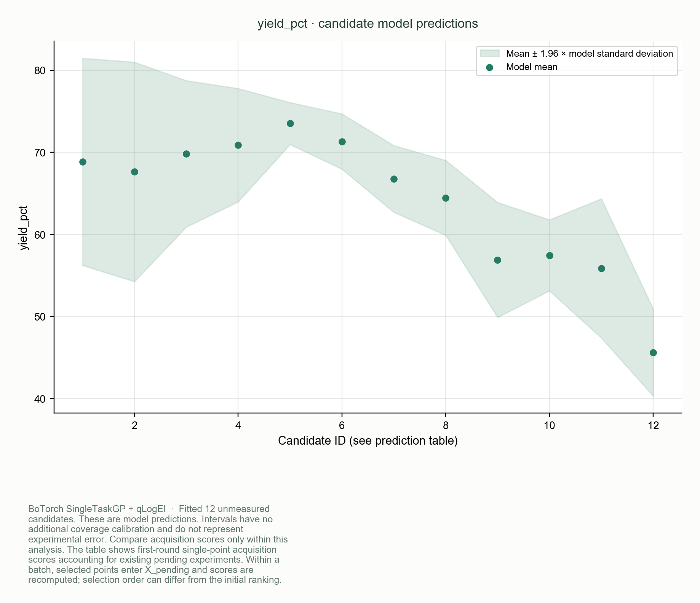
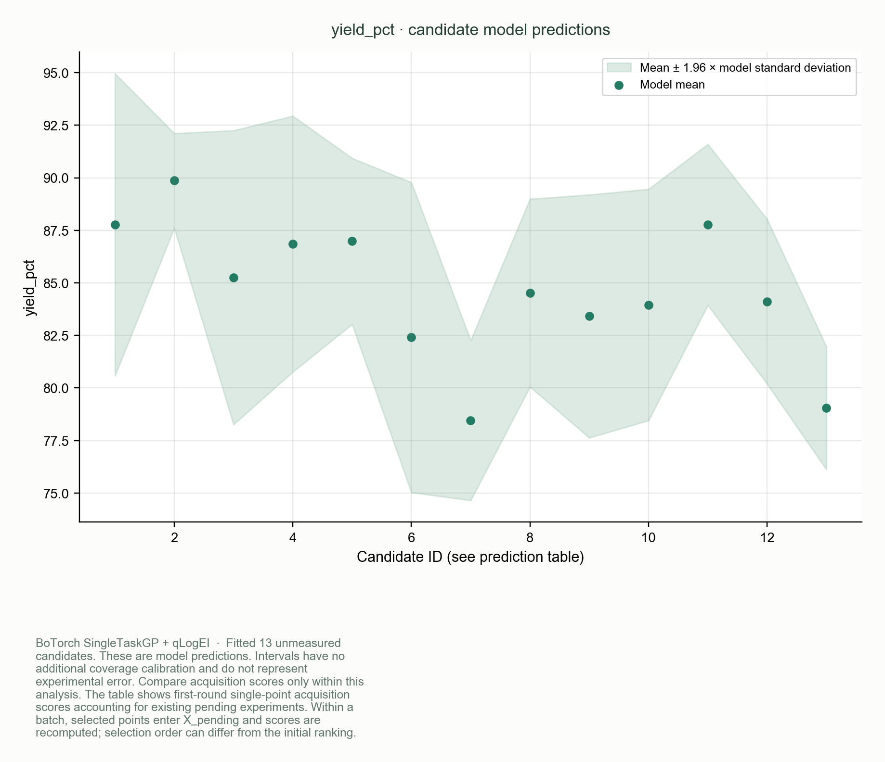
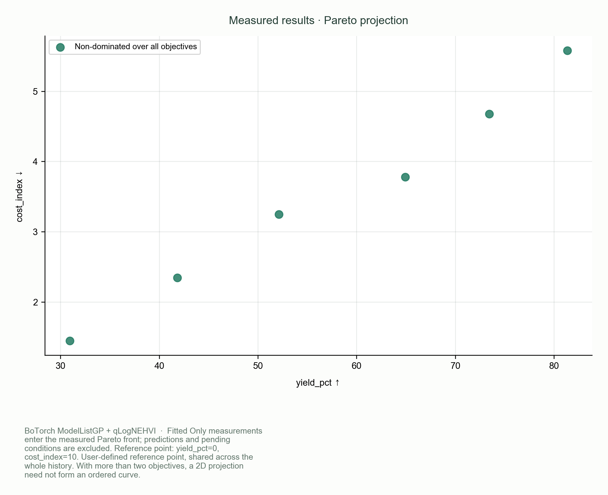
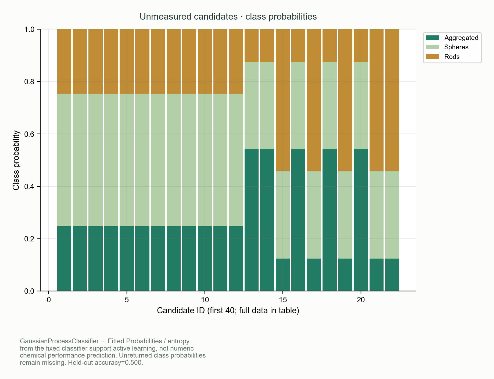
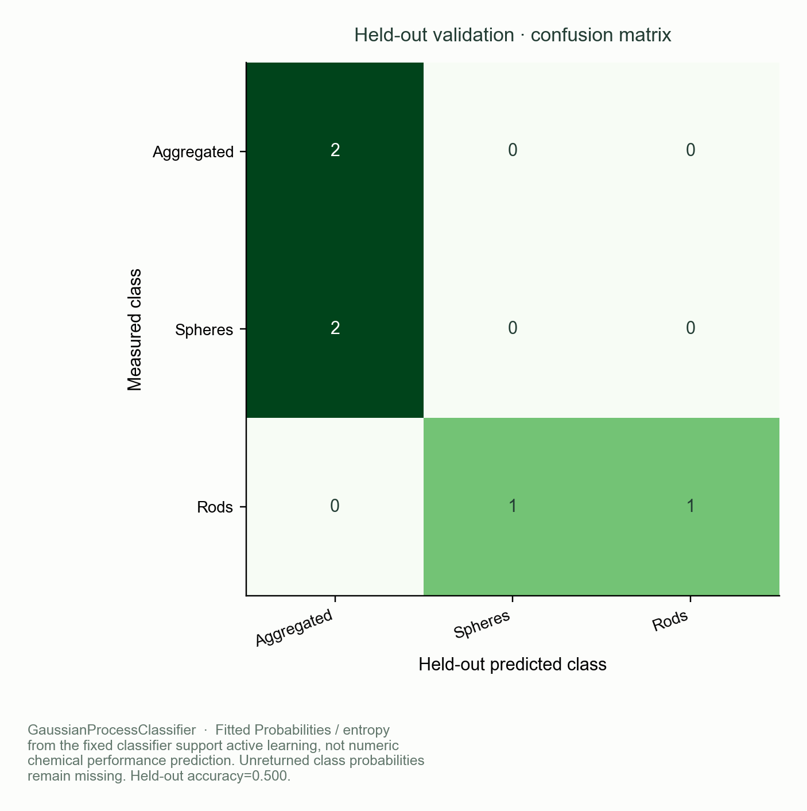
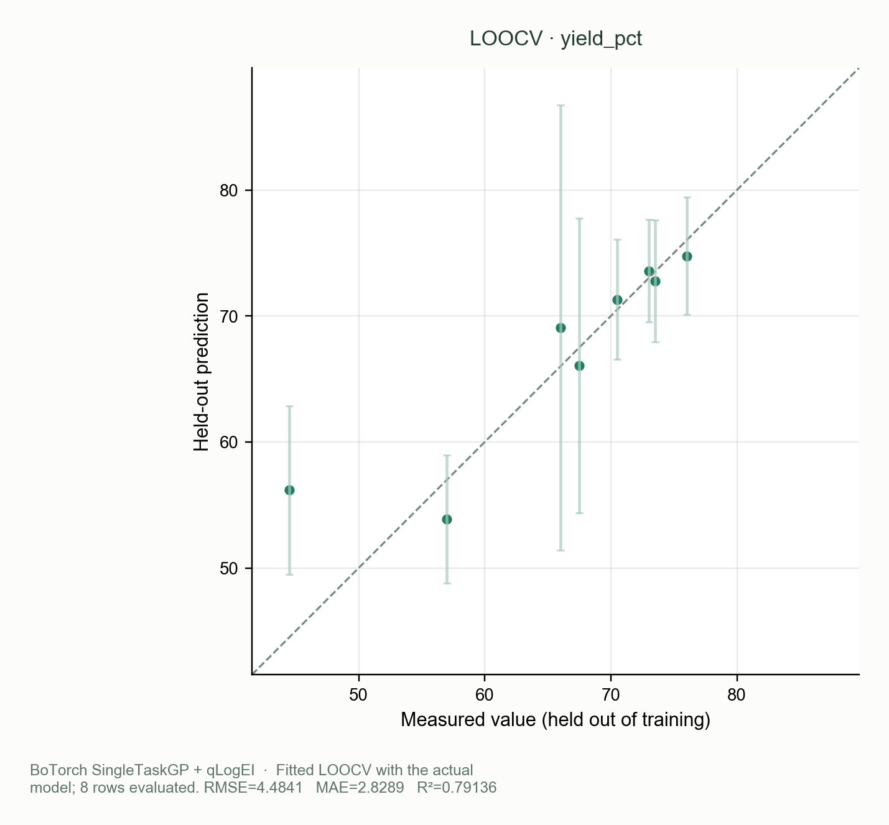

[简体中文](TUTORIAL.zh-CN.md) | [English](TUTORIAL.en.md) · [Back to README](../README.en.md)

# NanoBO: a practical guide for chemists

This guide describes the **0.2.3** desktop workflow. If an older installer does not have the tutorial Help entries or numbered practice files, update from [Releases](https://github.com/wei-rui499/NanoBO/releases).

This guide follows a familiar laboratory loop: **define the experiment → enter measurements → choose the next batch → run the experiment → add the results**. The supplied practice files let you complete that loop without doing a wet experiment.

The current application interface is Chinese. English explanations below include the exact Chinese labels that appear on screen. The documentation language switch does not change the application's interface language.

**All practice projects and result tables contain synthetic data.** They demonstrate software behavior; their numerical values are not recommended chemistry recipes. Use your own measured results in a research project.

## Contents

1. [Install and open the application](#1-install-and-open-the-application)
2. [Find your way around](#2-find-your-way-around)
3. [Ten-minute exercise: temperature, additive and yield](#3-ten-minute-exercise-temperature-additive-and-yield)
4. [Know which practice file to open](#4-know-which-practice-file-to-open)
5. [Create your own project](#5-create-your-own-project)
6. [Import, export and refill experimental results](#6-import-export-and-refill-experimental-results)
7. [Engines and priority objectives](#7-engines-and-priority-objectives)
8. [Executable recipes: steps, total volume, ratios and candidate tables](#8-executable-recipes-steps-total-volume-ratios-and-candidate-tables)
9. [Pareto and classification exercises](#9-pareto-and-classification-exercises)
10. [Model checks and every chart](#10-model-checks-and-every-chart)
11. [Save, export and archive](#11-save-export-and-archive)
12. [Troubleshooting and limits](#12-troubleshooting-and-limits)
13. [Complete control index](#13-complete-control-index)

## 1. Install and open the application

Download the installer and tutorial data from [GitHub Releases](https://github.com/wei-rui499/NanoBO/releases). Choose the installer for your operating system, not the developer source archive.

### Apple Silicon Mac

1. Use an M-series Mac with macOS 14 or later. The arm64 installer is not an Intel Mac installer.
2. Open the downloaded `macOS-arm64.dmg` and drag **NanoBO.app** into **Applications**.
3. Open NanoBO from Applications. The research preview is not Apple-notarized. If macOS blocks the first launch, review the app using [Apple's Privacy & Security instructions](https://support.apple.com/en-us/102445).
4. Create a normal document folder for your projects and exported tables; do not store your only copy inside the DMG.

### Windows

Use the Windows Hotfix1 installer or a later corrected release. Hotfix1 fixes the native model startup and logging issues reproduced in the original 0.2.3 test packages. Check the Windows acceptance record accompanying the particular installer; Mac validation does not replace Windows validation.

1. On Windows 10/11 x64, use the `windows-x64-setup-hotfix1-unsigned.exe` installer or a later corrected release.
2. Run the installer, choose the installation options, then open NanoBO from the Start menu or its shortcut. You do not need WSL, Python or a terminal to use the installed application.
3. The unsigned preview may trigger Windows reputation checks. Review the source and release information; do not disable Defender or other system protection.
4. Save experiment projects in your own Documents folder so they remain separate from installation files. Windows ARM64 is not part of the validated target described here.

### Open the guide and obtain the exercises

In the installed app, use **Help** (`帮助`) → **English tutorial** for this guide, or `中文使用教程` for Chinese. Choose **Export tutorial practice data** (`导出教程练习数据…`) and select a writable folder. Open the exported `01_quickstart`, `02_recipe`, `03_pareto` and `04_classification` folders.

The same files are in [`examples/tutorial/`](../examples/tutorial/) in the source package. The application's older **Teaching examples** (`教学示例`) button offers four small built-in demonstrations; these are separate from the numbered file-based exercises below. Use the numbered files when following the row-count checkpoints in this guide.

## 2. Find your way around

| Part of the window | What it is for |
| --- | --- |
| Top buttons | New project (`新项目`), small built-in teaching examples (`教学示例`), open (`打开`), save (`保存`), about and licenses (`关于 / 许可`). |
| Upper left | Project name, task, recommendation engine, class labels, batch size and random seed. |
| Variable table | The experimental conditions you are allowed to change: names, types, ranges, units and steps. |
| Objective table | The result you want to improve, or the class label you want to learn. |
| Completed experiments (`已完成实验`) | Measurements already available for training. Each row contains every variable and objective. |
| Next batch / pending (`下一批 / 待实验`) | Conditions planned but not yet measured. They are kept separate to prevent duplicate recommendations. |
| Run log (`运行日志`) | Progress, warnings and error details. |
| Models and visualization (`模型与可视化`) | Predictions, model checks, distributions, Pareto and classification plots. |
| Bottom controls | Generate next batch (`生成下一批实验 →`), analysis without adding experiments (`分析与交叉验证`), and cancel while computing (`取消计算`). |

The status line reports the number of completed and pending experiments. A dot in the window title means the project has unsaved changes. **Save explicitly** after importing or computing; the app does not automatically save the project to disk.

“Bayesian optimization” here means updating a model as measurements arrive and using that model to help choose the next experiments. You do not need to write code or set a model formula to follow this workflow.

## 3. Ten-minute exercise: temperature, additive and yield

Open [`01_quickstart/project.chembo.json`](../examples/tutorial/01_quickstart/project.chembo.json) with the app's **Open** (`打开`) button. Do not import the seed table into this already populated project.

The project has the following deliberately small, finite space:

| Field | Setting |
| --- | --- |
| `temperature_C` | 20–60 °C, in steps of 10 |
| `cycles` | Integer, 1–2 |
| `additive` | Category `A` or `B` |
| `yield_pct` | Numerical objective, maximize |
| Engine / batch / seed | BoTorch / 2 experiments / 42 |
| Candidate recipes / completed results | 20 recipes / 6 results |

### A. Inspect the existing measurements

1. Select **Completed experiments** (`已完成实验`). You should see **6 rows**, no pending conditions and a best measured synthetic yield of **73.5**.
2. Read the conditions and `yield_pct` columns. These are the inputs to the optimizer, not values predicted by it.
3. Choose **File → Save as** (`文件 → 项目另存为…`) and save a working copy with a new name.

### B. View predictions before adding a batch

1. Click **Analysis and cross-validation** (`分析与交叉验证`) and wait for the completion message. The first calculation can take longer while libraries start.
2. Open **Models and visualization → Candidate predictions** (`模型与可视化 → 候选预测表`). The starting project has **14 unmeasured candidates**: 20 possible conditions minus 6 completed ones.
3. Open **Model validation → Predicted and measured** (`模型验证 → 预测与实测`). Six completed measurements allow leave-one-out checks; see [Section 10](#10-model-checks-and-every-chart) for interpretation.
4. The completed and pending counts remain **6 and 0**. Analysis does not schedule experiments.

### C. Ask for the next two experiments

1. Click **Generate next batch** (`生成下一批实验 →`).
2. The app switches to **Next batch / pending** (`下一批 / 待实验`). Check that **2 rows** have been added. Each temperature is on a permitted step, `cycles` is an integer and the additive is an allowed category.
3. Do not expect the two highest entries in a previously sorted table to always equal a batch. After selecting the first condition, the numerical optimizer accounts for that newly pending point when selecting the next one.
4. The prediction table produced by this recommendation describes the pool at the time of that request. If you click **Analysis and cross-validation** again now, the **2 pending conditions are excluded**, leaving **12** candidates to analyze. The status still shows **6 completed / 2 pending**.

Exact recommendations and floating-point metrics can differ across platforms or numerical library versions. The practical checkpoints are the row counts, allowed conditions, complete results and clear model status.

### D. Complete a simulated batch

1. In the pending tab, click **Export CSV for results** (`导出待回填 CSV`). The exported file includes the variables and an empty `yield_pct` column.
2. Open `all-simulated-results.csv` in the same exercise folder. Find the rows with **all three variables matching** the exported conditions. Copy their synthetic `yield_pct` values into the exported file. Change only the result column.
3. Save as UTF-8 CSV. In NanoBO, use **Completed experiments → Import Excel / CSV** (`已完成实验 → 导入 Excel / CSV`) to import that completed file.
4. You should now have **8 completed / 0 pending**. The imported rows are appended, and matching pending conditions are removed automatically.
5. Save the project, then analyze or generate the next batch. Adding measurements invalidates the older analysis, so it must be recomputed.

In your real research, fill the CSV with actual measured values. The lookup table exists only because this is a synthetic exercise.

*Example output after 8 completed synthetic results: dots show predicted yield and the shaded band shows model uncertainty. The horizontal axis is candidate number, not temperature. The six example charts in this guide were exported from the actual NanoBO analysis view; they are model-output charts, not full-window screenshots or wet-lab results. Numerical values and recommended conditions can vary between runs and platforms.*

### E. A guaranteed refill-only exercise

If you want to learn import and reconciliation before running any model, open `pending-practice.chembo.json` in `01_quickstart`. It begins with **6 completed / 2 pending**. Import `followup-results.csv`; it contains exactly the results for those two fixed pending rows. The result must be **8 completed / 0 pending**.

Use this snapshot when importing `followup-results.csv`. That file is not a promise about the two conditions selected by a new optimization run.

## 4. Know which practice file to open

Every numbered exercise has the following files:

| File | Purpose |
| --- | --- |
| `project.chembo.json` | Ready project with **6 seed results**, definitions and feasible candidates. Open it directly to recommend or analyze. |
| `empty-project.chembo.json` | Same definitions with **0 results**. Use it to practice importing a seed table. |
| `pending-practice.chembo.json` | **6 completed / 2 fixed pending**. Import `followup-results.csv` to finish at **8 / 0**. |
| `seed-observations.csv`, `.xlsx`, `.xls` | The **same 6 seed results** in three formats. Import one format into an empty project, not all three. |
| `followup-results.csv` | Two additional synthetic results matching the fixed pending-practice snapshot. |
| `candidates.csv` | Variable columns only. Lists all feasible conditions from which future batches may be chosen. |
| `all-simulated-results.csv` | Synthetic lookup values for every candidate, used to fill whatever conditions your run recommends. Do not import this whole table for the optimization exercise. |

The Excel workbooks include `Results` and `ReadMe` worksheets. Select **Results** in the worksheet-selection dialog (`选择工作表`); the `ReadMe` worksheet is explanatory text.

| Exercise | Completed seed rows | Explicit candidates | Predictions in the first analysis, before scheduling a batch |
| --- | ---: | ---: | ---: |
| `01_quickstart` | 6 | 20 | 14 |
| `02_recipe` | 6 | 21 | 15 |
| `03_pareto` | 6 | 28 | 22 |
| `04_classification` | 6 | 28 | 22 |

Each main project uses BoTorch, batch size 2 and seed 42. These numbers apply to an unchanged starting project. Importing more rows, adding pending conditions or changing the domain changes the available pool.

Additional projects let you explore native Gryffin and Atlas recommendations, a third Pareto objective and binary labels; instructions follow below.

## 5. Create your own project

Start with **New project** (`新项目`). If you already have unsaved work, save it or choose the appropriate option in the confirmation dialog before proceeding.

### Set the basic fields

| Control | What to enter |
| --- | --- |
| Project name (`项目名称`) | A recognizable study or campaign name. |
| Task (`任务类型`) | Numerical / priority (`数值优化 / 优先级`), Pareto (`Pareto 多目标`) or classification (`分类主动学习`). |
| Engine (`推荐引擎`) | Start with BoTorch; see Section 7 for native Gryffin and Atlas. |
| Class labels (`分类标签`) | Used only for classification. Separate labels using `|`; they must match the result-table text exactly. |
| Batch size (`本批实验数`) | How many experiments you can run before obtaining the next measurements; 1–24. |
| Random seed (`随机种子`) | Keep a recorded integer, such as 42, for reproducible sampling and model settings. |
| Notes | Record units, measurement conventions, data source, instrument conditions and important decisions. |

### Define every variable you are allowed to change

Use **Add variable** (`＋ 变量`) and **Delete selected variables** (`删除选中变量`). Select a row using its row header before deleting it.

| Type in the app | Suitable for | Fields |
| --- | --- | --- |
| Continuous (`连续`) | Temperature, volume, concentration | Lower/upper bound; optionally a positive step. |
| Integer (`整数`) | Cycle count or another whole-number setting | Integer lower/upper bounds; optional integer step. |
| Category (`类别`) | Additive identity, solvent or catalyst choice | At least two distinct options separated by `|`; do not enter artificial numerical bounds. |

Names must be nonempty and distinct across both variables and objectives. A unit is a label for your records; the app does not convert mL to μL or °C to another scale. Use the same units in every imported row.

A step begins at the **lower bound**. For example, lower bound 20 with step 10 permits 20, 30, 40 and so on within the upper bound. A continuous variable with a blank step can vary continuously; an integer variable still requires whole numbers. See Section 8 before mixing steps with joint recipe rules.

Existing observations retain their original column names when you edit definitions. Renaming a variable does not relabel old experimental records. Prefer a new project for a new schema, or prepare an explicitly converted copy of the data.

### Define the result you want

Use **Add objective** (`＋ 目标`) and **Delete selected objectives** (`删除选中目标`).

- **One numerical objective:** choose **Maximize** (`最大化`) for higher yield or signal, or **Minimize** (`最小化`) for lower cost or error. Write down whether a yield is stored as 75 or 0.75; keep that convention throughout.
- **Competing numerical objectives:** choose Pareto and define at least two goals, each with its own direction.
- **Class labels:** choose classification, keep exactly one result column and declare at least two labels. A text label is not a numerical yield.
- **Gryffin priorities:** the objective rows define the priority order. The visible relative-tolerance field belongs to this workflow; see Section 7.

Save once after completing definitions, then import measurements. A new project starts with default variables and an objective; edit or remove the defaults rather than accidentally retaining them as extra columns.

## 6. Import, export and refill experimental results

### Import a complete results table

1. For a clean practice import, open `empty-project.chembo.json` in any exercise folder.
2. Select **Completed experiments → Import Excel / CSV** (`已完成实验 → 导入 Excel / CSV`). Choose one `seed-observations` file.
3. For Excel, choose **Results** when prompted. CSV has no worksheet prompt.
4. Check that there are **6 completed rows**. Save a working copy.

A results file must contain **exactly all variable and objective column names**; column order may differ. For the quickstart, these are `temperature_C`, `cycles`, `additive` and `yield_pct`. Do not add units, comments or a second header row inside the table. Put context in project notes or a separate worksheet.

The reader supports UTF-8 CSV, legacy XLS and XLSX. It rejects missing values, duplicate headers, invalid numbers, unknown categories, off-step values and rows outside the permitted domain. Entirely blank rows are skipped. It reads saved Excel formula results without evaluating formulas; a formula without a cached value is treated as missing. Saving a copy with values only is often the clearest exchange format.

**Import appends rows; it does not replace existing measurements.** Importing the same seed table again creates repeated measurements, which the app allows. When practicing the six-row checkpoint, open the empty project each time you compare CSV, XLS and XLSX.

### Add or correct rows by hand

Use **Add a row** (`＋ 录入一行`) and fill every variable and target cell. Existing completed cells are editable. To delete a row, select its row header and click **Delete selected rows** (`删除选中行`). A partially completed row must be completed or removed before the project can be validated and saved.

Repeated measured experiments may be kept as separate rows. They are not automatically averaged; data-distribution counts include them. Keep enough notes to distinguish a deliberate replicate from an accidental repeated import.

### Keep pending conditions separate from results

The pending table is read-only and contains no measured target values. It prevents the same or a nearly identical condition from being scheduled again while you wait for results.

You have two refill routes:

- **Spreadsheet route:** export pending CSV, fill every objective column with measurements, then import the completed file. Matching pending rows disappear; unrelated pending rows remain.
- **Manual route:** select pending rows and click **Move selected conditions to results table** (`将选中条件转入结果表`). Complete the blank target cells in the completed table. Save after all values are entered; matching pending entries are reconciled when the data are collected and validated.

Do not replace unknown targets with 0 or with model predictions. A scheduled experiment becomes a measurement only after its result is available.

If a condition will not be run, select it and click **Withdraw selected conditions** (`撤回选中条件`). It is removed from the queue and can become eligible for recommendation again. Withdrawal does not create a measurement.

### Export measurements

Choose **Export results** (`导出结果`) in the completed tab to save a CSV of variables and measured objectives. This is different from **Export prediction table CSV** in the model view. Use clear filenames such as `measured-results.csv`, `next-batch-to-measure.csv` and `model-predictions.csv`.

## 7. Engines and priority objectives

The main four practice projects use **BoTorch · 优化与分类**, because it supports the recipe and analysis features demonstrated here.

| Workflow | BoTorch | Native Gryffin | Native Atlas |
| --- | --- | --- | --- |
| One numerical objective, continuous/integer/category variables | Yes | Yes | Yes |
| Multiple priorities using Chimera | No | Yes | No |
| Explicit steps, joint constraints or candidate table | Yes | Not exposed by these native adapters | Not exposed by these native adapters |
| Pareto or classification | Yes | Not this GUI workflow | Not this GUI workflow |
| Current posterior plots and same-model cross-validation | Yes | Not exposed | Not exposed |

The app validates the selected combination. Choosing an incompatible engine produces a message; it does not silently run a different algorithm.

### Try native Gryffin and Atlas with the same starting measurements

In `01_quickstart`, open `gryffin-project.chembo.json` or `atlas-project.chembo.json`. Each keeps the six seed observations but removes the explicit candidate table and numerical steps, allowing its native adapter to operate over the configured ranges. Generate a batch, inspect the pending rows and save the result.

Do not use the finite lookup table to invent a value for a native recommendation that is not present there. The continuous native domain may recommend other temperatures. This exercise checks the native ask/tell interface; use actual measurements to continue a real study.

For native Gryffin and Atlas, a blank model-diagnostic panel is not a fitted-model prediction. Their native recommendations have not been replaced by a separate surrogate solely to populate the plots. To practice the current diagnostics, reopen the BoTorch teaching project.

### Gryffin / Chimera priorities

Select numerical / priority mode and Gryffin. Put the most important objective first, followed by lower priorities. Set a direction for each target. The **Relative tolerance** (`容忍比例 (0–1)`) controls how Chimera handles its priority objectives relative to the observed objective ranges. It is not an experimental error bar, a percent yield loss or a recipe acceptance limit.

Start with the provided/default value unless you have a reason to change it and understand the method. Record the order and tolerances used. If you want to inspect simultaneous trade-offs rather than enforce an order of priorities, use Pareto mode instead.

The interface does not expose a menu of GP, random forest, SVM, EI or UCB variants. BoTorch numerical workflows and the classifier use fixed methods, described in the [feature guide](V0.2_FEATURES.md) and [citation guide](HOW_TO_CITE.md).

## 8. Executable recipes: steps, total volume, ratios and candidate tables

Open [`02_recipe/project.chembo.json`](../examples/tutorial/02_recipe/project.chembo.json). It defines `A_mL`, `B_mL` and `aging_min`, with `yield_pct` to maximize. Both volumes have bounds 0.1–0.9 mL and step 0.1; aging is an integer from 10–30 minutes with step 10.

The joint requirements are:

- `A_mL + B_mL = 1`;
- `0.25 ≤ A_mL / B_mL ≤ 4`;
- only conditions listed in `candidates.csv` may be recommended.

The candidate table contains **21 feasible recipes**. With six measured rows, the first analysis has **15** unmeasured candidates. A two-condition recommendation must obey all limits simultaneously.

*Example output after 8 completed synthetic results: predicted yield and model uncertainty for the remaining feasible recipe candidates. Check the corresponding table to read the actual volumes and aging times; the horizontal axis is a candidate identifier.*

### Set a dispensing or operating step

Enter the step in the variable table's **Step** (`步长`) column. A 0.1 mL step beginning at 0.1 mL permits 0.1, 0.2, …, 0.9. Steps are part of candidate construction, not rounding applied after the model recommends a condition.

### Add a total-volume or linear rule

1. Click **Recipe constraints / candidate table** (`配方约束 / 候选表…`).
2. Click **Add total / linear** (`＋ 总量／线性`).
3. For this exercise, set coefficients: `A_mL = 1`, `B_mL = 1`, **`aging_min = 0`**. Time must not be added to volume.
4. Choose relation `=` and right-hand value `1`, then confirm. Other supported relations are `≤` and `≥`.
5. Finish with **Apply using BoTorch** (`应用（使用 BoTorch）`). The complete project, including observations and pending conditions, must remain valid.

If you are recreating a rule, delete its existing row first rather than adding a duplicate. All enabled rules apply together. Use consistent units or supply appropriate coefficients yourself; units are not converted automatically.

### Add a ratio limit

In the same dialog, choose **Add ratio** (`＋ 配比`). Set numerator `A_mL`, denominator `B_mL`, minimum 0.25 and maximum 4. The denominator must be positive. Equal minimum and maximum values can specify a fixed ratio.

### Import a permitted recipe table

Click **Import feasible candidate table** (`导入合法候选表（Excel / CSV）`) and choose `candidates.csv`. It contains **only the three variable columns** and no `yield_pct`. Select the intended worksheet if using Excel. The dialog displays the candidate count and previews up to 30 rows.

The next batch is chosen only from that table while also obeying steps and joint rules. Historical measurements may come from outside the current candidate table, but still have to satisfy variable bounds, steps and joint constraints. Pending conditions must be in the candidate table. Duplicate or nearly identical candidate rows are rejected.

### Remove a restriction deliberately

- **Delete selected rule** (`删除选中规则`) removes only the selected linear/ratio rule.
- **Clear candidate table** (`清除候选表`) removes only the explicit table. Ranges, steps and other rules remain.
- The main-window **Clear joint restrictions** (`清除联合限制`) removes both joint rules and the candidate table. Variable steps remain until you clear their cells separately.

For a useful exercise, open the provided project, clear only its candidate table, then analyze again. Its finite step grid and joint rules still generate the same 21 feasible recipe combinations. Avoid changing a variable referenced by a rule until you have deliberately updated or removed that rule.

## 9. Pareto and classification exercises

### A. Yield versus cost: Pareto

Open [`03_pareto/project.chembo.json`](../examples/tutorial/03_pareto/project.chembo.json). It uses `temperature_C` from 20–80 in steps of 10 and `ligand_mM` from 0.5–2 in steps of 0.5. There are 28 candidate conditions and six completed results. The objectives are **maximize `yield_pct`** and **minimize `cost_index`**; the index is synthetic, not a currency price.

1. Confirm **Pareto multi-objective** (`Pareto 多目标`) is selected and inspect each objective's direction.
2. Click **Analysis and cross-validation**. The first prediction table has **22** candidates.
3. In **Pareto multi-objective → 2D Pareto** (`Pareto 多目标 → 二维 Pareto`), choose `yield_pct` and `cost_index` for the two axes.
4. The emphasized points are measured **non-dominated** results: no other measured result is at least as good in every configured objective and better in one. They offer alternatives, not one universal winner.
5. Generate two conditions, export and fill results from matching rows in `all-simulated-results.csv`, then import and repeat. Use `pending-practice.chembo.json` plus `followup-results.csv` for the fixed **6/2 → 8/0** import checkpoint.

*Example output after 8 completed synthetic results: green points are non-dominated outcomes in the configured objectives. The plot shows the yield–cost trade-off among completed synthetic experiments, not predictions for unmeasured conditions.*

Open `three-objective-project.chembo.json` to add synthetic `waste_index` as a third objective to minimize. Its lookup file is `three-objective-all-simulated-results.csv`; its seed table is `three-objective-seed.csv`. Select **3D Pareto** (`三维 Pareto`) and choose three different X/Y/Z objectives. A project with only two objectives cannot produce a valid three-axis objective plot.

The **Hypervolume history** (`超体积历史`) tracks the measured Pareto set relative to one reference point within that analysis. The automatic reference point can change when new measurements arrive. Do not compare absolute hypervolume values from separate analyses with changing reference points. A fixed reference can be supplied in project JSON, but the current GUI does not provide a reference-point editor.

### B. Morphology labels: classification

Open [`04_classification/project.chembo.json`](../examples/tutorial/04_classification/project.chembo.json). It uses the same 28-condition temperature/ligand domain, with a single target column **`morphology`** and labels **`团聚 | 球形 | 棒状`** (aggregated / spherical / rod-like). The six seed results contain two of each class.

1. Confirm **Classification active learning** (`分类主动学习`) and BoTorch are selected. The objective-direction control is inactive for a label task.
2. Analyze the starting project. The table has **22** unmeasured candidates and class-probability columns for the observed classes.
3. Open **Classification analysis** (`分类分析`). Compare **Candidate class probabilities** (`候选类别概率`) and **Classification uncertainty** (`分类不确定性`).
4. Generate two conditions and fill their `morphology` values by matching conditions in this exercise's synthetic lookup table. Import the completed rows, save and reanalyze.
5. Use `pending-practice.chembo.json` with `followup-results.csv` to practice the exact **6/2 → 8/0** transition.

*Example output after 8 completed synthetic results: each stacked bar shows model probabilities for an unmeasured candidate. Colors correspond to the declared morphology labels; the bars are predictions, not observed particle images or measured class counts.*

A high entropy score means the classifier is uncertain about the class. This workflow explores class boundaries; it does not maximize the probability of any chosen “successful” class. At least two classes must have been observed before the classifier supplies probabilities. With fewer, the app performs an initial spread-out design. A declared but unobserved class is not assigned a fabricated zero probability.

*Example validation output for 8 completed synthetic results: rows are held-out actual labels and columns are predicted labels. Off-diagonal counts show classification errors; this illustrative run predicts 5 of 8 held-out labels correctly. These numbers are not a required score or evidence of real chemistry performance.*

For a two-label exercise, open `binary-project.chembo.json` and use `binary-all-simulated-results.csv` for lookup. It uses an `outcome` column with `成功` / `失败`. Do not import the morphology table into the binary project: the target names and label sets differ.

## 10. Model checks and every chart

### Predictions and recommendations are different

In BoTorch numerical tasks, at least two completed measurements allow model fitting. With fewer, the app gives an initial spread-out design and does not invent posterior predictions. Classification requires observed data from at least two classes.

Clicking **Generate next batch** updates pending conditions. Clicking **Analysis and cross-validation** recomputes the candidate predictions and diagnostics **without adding pending experiments**. Both use the project's current data. Editing measurements, settings, the queue or the domain invalidates old analysis; run analysis again when you need current plots.

### Candidate prediction table (`候选预测表`)

- `候选编号`: the identifier used to match points and table rows in this analysis.
- `本批推荐`: whether a candidate was selected by the recommendation request that produced the analysis.
- Variable columns: the actual proposed experimental conditions.
- Numerical objectives: predicted mean (`预测`) and model standard deviation (`标准差`) for each target, in the target's original scale.
- Classification: `P(label)` columns and entropy (`熵`).
- Acquisition score (`采集分值`): a criterion for selecting informative/useful experiments in this calculation, not a measured yield.

Click column headers to sort. The saved numerical scores are the first single-point scores accounting for already pending experiments. Later selections within a batch are rescored with earlier selections treated as pending; batch order can therefore differ from that initial ranking. Scores labelled logEI/logNEHVI may be negative and are comparable within the same analysis, not across unrelated tasks or iterations.

### All plot selectors

| Tab and selector in the app | What to look for |
| --- | --- |
| Prediction and exploration (`预测与探索`) → Candidate prediction and interval (`候选预测与区间`) | Candidate means with mean ± 1.96 × model standard deviation; stars identify selected candidates when available. This is model uncertainty, not an experimental error bar or a calibrated coverage guarantee. |
| `预测与探索` → Mean and uncertainty (`预测均值与不确定性`) | The balance between predicted response and uncertainty. A high predicted mean and a highly uncertain condition answer different planning questions. |
| `预测与探索` → Acquisition-score ordering (`采集分值排序`) | How the current candidate pool is ranked by the selection criterion. |
| Model validation (`模型验证`) → Predicted and measured (`预测与实测`) | Leave-one-out predictions against held-out measurements. Points closer to the identity line indicate smaller errors on those checks. |
| `模型验证` → Validation errors (`验证误差`) | Predicted minus measured values by held-out record; inspect systematic shifts and unusually large errors. |
| Data distribution (`数据分布`) → Observed distribution (`观测分布`) | A numerical histogram or categorical count plot for the variable/result chosen in the adjacent dropdown. Only completed measurements are counted. |
| `数据分布` → Measurement history (`实测历史`) | Results in stored row order; numerical objective plots include running best measured values. Row order is not elapsed time. |
| Pareto (`Pareto 多目标`) → 2D Pareto (`二维 Pareto`) | Two selected objective axes, emphasizing the measured points that are non-dominated over all configured objectives. |
| `Pareto 多目标` → 3D Pareto (`三维 Pareto`) | Three distinct objective axes; use the supplied three-objective project. |
| `Pareto 多目标` → Hypervolume history (`超体积历史`) | Measured trade-off-set progress within a common reference point. |
| Classification (`分类分析`) → Candidate probabilities (`候选类别概率`) | Probabilities for up to the first 40 candidates in the chart; export the table for all candidates. |
| `分类分析` → Classification uncertainty (`分类不确定性`) | Entropy: larger means a more uncertain class prediction. |
| `分类分析` → Observed class distribution (`已测类别分布`) | How many completed results belong to each declared class. |
| `分类分析` → Confusion matrix (`混淆矩阵`) | Held-out measured classes versus predicted classes. Diagonal entries are correct predictions for the evaluated rows. |

Use **View objective** (`查看目标`) to switch numerical targets. The distribution page has its own variable selector; the Pareto page has X/Y/Z selectors. A two-axis projection of a higher-dimensional Pareto set need not form an ordered curve. Predicted and pending points are not included in the **measured** Pareto front.

The Matplotlib toolbar supports home/reset, back/forward, pan and zoom. Click a pickable candidate point to see its conditions in the detail text below the plot. These interactions change the view, not the experimental data.

### What leave-one-out validation does

For each selected completed row, the app removes that row from model training, refits the **same model used by this workflow**, and predicts the held-out result. The check needs at least **3 completed rows**. With more than 30 rows, it chooses up to 30 reproducible holdouts; each fold still trains on all other records. Read the displayed evaluated count.

| Metric | Plain-language interpretation |
| --- | --- |
| RMSE | Typical prediction error with greater weight on large errors; uses the target's units. |
| MAE | Average absolute prediction error, also in target units. |
| R² | Agreement relative to predicting a constant mean; may be negative and is left blank when all actual values are identical. |
| Classification accuracy | Fraction of evaluated held-out labels predicted correctly. Read it together with the confusion matrix and class counts. |

*Example validation output after 8 completed synthetic results: each value was predicted with that row held out of training. The dashed line marks perfect agreement; error bars show model uncertainty. Read the displayed evaluated-row count and error metrics for your own data rather than expecting this example's exact values.*

A classification fold that would leave only one training class is skipped; the displayed evaluated count may be smaller than the total. A small or unbalanced dataset can make accuracy unstable. These checks describe the current dataset, not an independent external validation of a chemical mechanism.

If a plot is unavailable, read its explanation: the task may not apply, the model may still be in initial design, a native engine may not expose that diagnostic, or too few valid observations may be available. An empty panel does not supply an inferred performance result.

## 11. Save, export and archive

### Save a resumable project

- **Save** (`保存`) or **File → Save project** (`文件 → 保存项目`): save the current project.
- **Save as** (`文件 → 项目另存为…`): create a separate version.
- **Open** (`打开`): resume a `.chembo.json` / `.json` project.

The project records settings, measurements, pending conditions, notes, calculation history and the latest available analysis. Do not enter targets for experiments that have not been measured. Keep round-by-round project copies when documenting a campaign.

| Action | Mac shortcut | Windows shortcut |
| --- | --- | --- |
| New | ⌘N | Ctrl+N |
| Open | ⌘O | Ctrl+O |
| Save | ⌘S | Ctrl+S |
| Save as | ⌘⇧S | Ctrl+Shift+S |

The app prompts about unsaved changes before replacing or closing a project. Data processing is local; exporting or saving a file does not upload it to GitHub.

### Export a plot or a prediction table

1. Select **Models and visualization**, the relevant subtab and the exact plot selector you want.
2. Choose **Export current plot** (`导出当前图…`) and select PNG, PDF or SVG. The export includes model/status and explanatory text.
3. Choose **Export prediction table CSV** (`导出预测表 CSV…`) for candidate conditions and model outputs. This file is not an experimental-results table.
4. If the candidate-table subtab is active, plot export uses the appropriate prediction chart instead of taking a screenshot of the table.

For a group meeting, archive the saved project, measured-results CSV, prediction CSV and selected figures together. Keep exported figures associated with their data snapshot; a later project update does not update previously exported files.

### Cancel and inspect a calculation

During computation, **Cancel calculation** (`取消计算`) stops the current worker. Existing experimental records are preserved. Inspect **Run log** (`运行日志`) when a computation fails or takes longer than expected; a failed model is reported rather than silently substituted with a successful-looking result. Save the project before sending a bug report, and remove confidential experimental details from any material you choose to share.

### Find licenses and citation information

Use **About / licenses** (`关于 / 许可`) or **Help → About NanoBO** (`帮助 → 关于 NanoBO`). The dialog includes an **Open bundled licenses folder** (`打开随附许可证文件夹`) button. Cite the scientific methods you actually used, together with NanoBO: [citation guide](HOW_TO_CITE.md), [acknowledgments](../ACKNOWLEDGMENTS.md), [BibTeX references](../REFERENCES.bib).

## 12. Troubleshooting and limits

| Symptom | What to check |
| --- | --- |
| An import reports incorrect column names | Start from an exported template. Match every variable and target name exactly; remove extra comment/unit columns. |
| The seed exercise has 12 rows instead of 6 | The seed table was imported twice. Reopen `empty-project.chembo.json` and import one format once, or deliberately remove accidental duplicates in a working copy. |
| Excel asks for a worksheet | Choose `Results` for the supplied workbooks. |
| A formula cell is missing on import | Save a values-only copy or ensure Excel has calculated and saved cached values. NanoBO does not evaluate spreadsheet formulas. |
| A category or class is rejected | Match the declared spelling and label; spaces inside a name, Chinese versus English words and different labels are not interchangeable. |
| A value is outside a step or recipe rule | Check lower bound, step origin, units, total-volume coefficients and positive ratio denominator. |
| No feasible candidates / too few candidates | Check conflicting limits and whether measured/pending points exhaust the table. Reduce batch size or revise a scientifically justified domain. |
| Pareto or classification selects BoTorch | These task modes use the enhanced BoTorch workflow. Native Gryffin/Atlas adapters do not expose these GUI tasks. |
| Analysis button is disabled | Select BoTorch and wait for any current computation to finish. |
| Predictions or class probabilities are absent | Numerical fitting needs at least two measured rows; classification fitting needs at least two observed classes. Initial designs do not have fabricated predictions. |
| Cross-validation is empty | At least three completed rows are needed; some classification folds may leave too few classes. Read the panel note. |
| 3D Pareto has no plot | Choose three different objectives in a project with at least three numerical targets. |
| Old charts disappear after an edit/import | They are tied to the previous data snapshot. Reanalyze the updated project. |
| A new batch repeats an old measurement | Check whether the historical results were actually imported into the current project and whether variable names/units changed. The same or nearly identical completed/pending condition is excluded by the normal workflow. |
| A computation reports a model error | Read the run log, confirm complete and finite inputs, preserve a project copy and report the actual error. Do not treat a failed request as a finished recommendation. |

Practical computation bounds:

- A finite source grid is limited to **200,000 combinations before constraint filtering**. For a larger space, increase steps, narrow ranges or provide a smaller explicit candidate table.
- One scoring request uses at most **4,096 feasible unmeasured candidates**. Larger tables and continuous domains use a reproducible generated/subsampled pool. The ranking describes that pool, not a guarantee of the global optimum over the entire continuous space.
- Completed replicates are allowed; pending duplicates are not. For continuous variables, points within the app's `1e-6` range-relative near-duplicate threshold are treated as nearly identical.
- Numerical validation uses up to **30** held-out rows. Read evaluated/total counts before interpreting metrics.
- The app does not validate chemical safety, solubility, physical plausibility or instrument limits unless you encode the relevant allowed domain. Choose experimental ranges and recipes using your laboratory knowledge.

## 13. Complete control index

| Control / feature | Where it is explained |
| --- | --- |
| Install, offline guide and copy teaching files | Section 1 |
| New/open/save/save as, unsaved-work prompt | Sections 5 and 11 |
| Built-in teaching examples versus file-based exercises | Sections 1 and 4 |
| Project name, task, engine, labels, batch, seed and notes | Sections 5 and 7 |
| Add/delete variables; continuous/integer/category; units and steps | Sections 5 and 8 |
| Add/delete objectives; maximize/minimize; Gryffin priority tolerance | Sections 5 and 7 |
| Linear/total/ratio rules; import/clear candidates; clear joint restrictions | Section 8 |
| Manual row entry/edit/delete; CSV/XLS/XLSX and worksheet import | Section 6 |
| Export results/pending; refill; move pending to results; withdraw pending | Section 6 |
| Generate batch, analysis-only, queue protection and duplicate prevention | Sections 3, 6 and 10 |
| All prediction/validation/distribution/Pareto/classification chart selectors | Section 10 |
| Objective/variable/axis selectors, sorting, point inspection, pan/zoom | Section 10 |
| Figure and prediction exports; project archive | Section 11 |
| Progress, cancel, run log and input errors | Sections 11 and 12 |
| About, bundled licenses and original research citations | Section 11 |

For the exact scientific implementations and data fields, see [features](V0.2_FEATURES.md), [validation records](VALIDATION.md), [upstream modification records](UPSTREAM_MODIFICATIONS.md) and [how to cite](HOW_TO_CITE.md).
