# SynthBO 使用教程：跟着模拟实验学会规划下一批

希望每一步都有截图时，直接按[64 步逐步截图指南](STEP_BY_STEP.zh-CN.md)操作。本教程全部截图和导出图采用英文界面，配套数据位于 en/ 文件夹。

**简体中文** | [English](TUTORIAL.en.md) | [返回项目首页](../README.md)

本教程对应 **SynthBO 0.2.5**。窗口右上角的 **English / 中文** 按钮可即时切换界面语言，无需重启。菜单、配方设置、图表、预测表表头及导出提示一并切换，重新打开后仍保留上次选择。项目名称、变量名、单位、类别标签、备注和实验数值保持原文；切换时不会清空未保存的输入、图表或正在运行的计算。

“使用教程”按钮会打开当前界面语言的离线指南；“帮助”菜单也可分别打开中文、英文教程。第三方引擎的原始运行日志保留其原文，便于排错。

这份教程面向会设计实验、会用 Excel，但没有编程经验的化学研究者。你不必先学习贝叶斯优化公式：把已有实验放进软件，让软件建议下一批条件；做完实验，再把结果填回来。

教程中的产率、形貌、成本和配方全部是 **SYNTHETIC / 模拟教学数据**，由数学规则生成，用于练习软件，不代表真实化学体系，也不是实际合成操作建议。先做第 2 节，再按需要学习配方约束、多目标和分类。

## 目录

- [1. 安装与第一次打开](#1-安装与第一次打开)
- [2. 十分钟完成一次实验循环](#2-十分钟完成一次实验循环)
- [3. 练习文件的用法](#3-练习文件的用法)
- [4. 从零建立自己的项目](#4-从零建立自己的项目)
- [5. 总量、步长与合法配方](#5-总量步长与合法配方)
- [6. Pareto 多目标](#6-pareto-多目标)
- [7. 分类主动学习](#7-分类主动学习)
- [8. 读懂模型与可视化](#8-读懂模型与可视化)
- [9. Gryffin、Atlas 与引擎选择](#9-gryffinatlas-与引擎选择)
- [10. 保存、导出与项目记录](#10-保存导出与项目记录)
- [11. 常见问题](#11-常见问题)
- [12. 完整功能索引](#12-完整功能索引)

## 1. 安装与第一次打开

从 [GitHub Releases](https://github.com/wei-rui499/SynthBO/releases) 下载与你的电脑匹配的安装包。应用已包括计算引擎，日常使用不需要安装 Python、WSL、Docker 或申请 API 账户。科学计算在本机进行；打开在线 GitHub 链接才需要联网。

| 电脑 | 安装方法 | 当前状态 |
| --- | --- | --- |
| Apple Silicon Mac（M 系列，macOS 14+） | 打开 `.dmg`，把 SynthBO.app 拖入 Applications，再从 Applications 启动 | 科研测试包尚未 Apple 公证。若系统提示无法确认开发者，可在系统“隐私与安全”中检查应用来源并选择允许打开；无需修改系统级安全设置。 |
| Windows x64 | 使用 Windows Hotfix1 或后续修复版安装器，运行后从开始菜单启动 | Hotfix1 修复了原 0.2.3 测试包的模型启动与日志问题；以该安装包随附的 Windows 验收记录为准。 |
| Intel Mac | 暂不使用 arm64 的 Mac 包 | 当前没有经过验证的 Intel Mac 完整安装包。 |

窗口左侧是“这个实验允许怎样做”，右侧是“已经做过什么、接下来做什么”，底部显示已完成和待实验的数量。

新版 **帮助 → 中文使用教程 / English tutorial** 打开随应用附带的离线教程。**帮助 → 导出教程练习数据…** 把练习复制到你指定的文件夹。请使用这份可写副本，不直接修改安装目录。源码用户也可使用 [examples/tutorial](../examples/tutorial)。下文的 `examples/tutorial` 指仓库内位置；安装应用导出后，它对应你保存的练习根目录，各个 `01_quickstart` 等文件夹的用法相同。

本教程的英文截图使用导出数据中 **en/** 文件夹下的样例。原始中文标签目录仍可使用；分类数据不可混用两种语言的标签。英文标签对应关系为 Aggregated＝团聚、Spheres＝球形、Rods＝棒状、Success＝成功、Failure＝失败。


[逐步截图说明](STEP_BY_STEP.zh-CN.md)


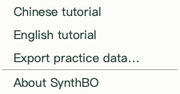

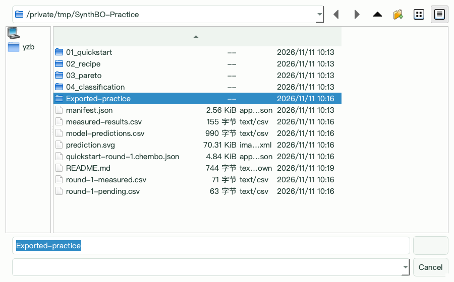

## 2. 十分钟完成一次实验循环

这一节使用 `examples/tutorial/01_quickstart`，先不改任何参数。

### 2.1 打开已经填好数据的项目

1. 点顶部 **打开**，选择 `en/01_quickstart/project.chembo.json`。
2. 检查底部：**已完成 6 个实验，待实验 0 个**。
3. 左侧应为 **数值优化 / 优先级**、**BoTorch · 优化与分类**、本批实验数 **2**、随机种子 **42**。

本例假想要提高模拟 `yield_pct`。A、B 只是类别名称，不代表实际化学品。

| 列名 | 如何理解 | 允许取值 |
| --- | --- | --- |
| `temperature_C` | 温度 | 20、30、40、50、60 °C |
| `cycles` | 整数次数 | 1 或 2 |
| `additive` | 添加剂类别 | A 或 B |
| `yield_pct` | 已完成实验的模拟产率 | 数值，目标为最大化 |

共有 20 个合法组合，6 个已有结果，初始最佳模拟产率为 **73.5**。打开项目已载入这些设置，不需要重新输入。


[逐步截图说明](STEP_BY_STEP.zh-CN.md)

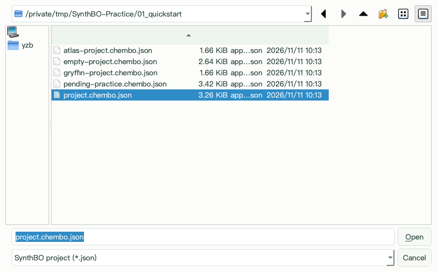

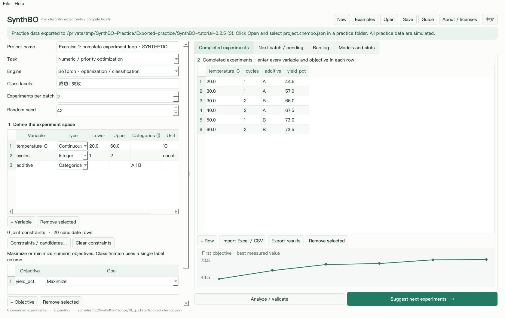


### 2.2 先看模型如何理解已有数据

1. 点 **分析与交叉验证**，等待完成。
2. 在 **模型与可视化 → 候选预测表**应看到 **14 个未测候选**。
3. 每行有变量条件、`yield_pct · 预测`、`yield_pct · 标准差`和采集分值。
4. 切换 **模型验证 → 预测与实测**，应显示 **验证 6 行**，以及 RMSE、MAE、R²。

分析只检查模型，不排队新实验，此时仍为 6 个已完成、0 个待实验。预测的具体小数可能随平台或数值库版本略有差异；首先检查任务状态、候选数量和数据对应关系。


[逐步截图说明](STEP_BY_STEP.zh-CN.md)

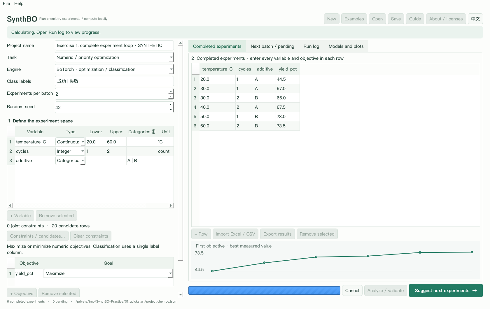

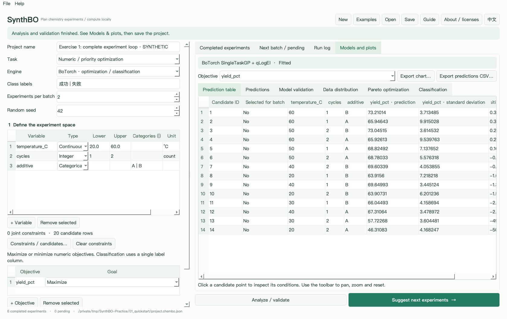

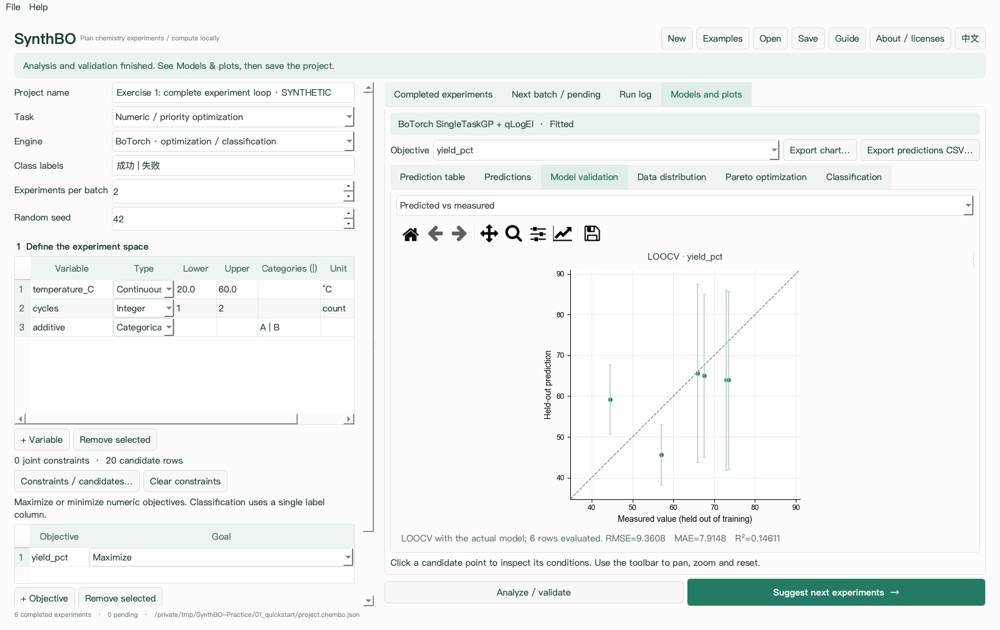

### 2.3 让软件提出下一批条件

1. 点 **生成下一批实验 →**。
2. 完成后进入 **下一批 / 待实验**，应有 **2 行条件**。
3. 底部为 **已完成 6 个，待实验 2 个**，原来的结果不会变成 8 条。
4. 点 **导出待回填 CSV**，保存为 `round-1-pending.csv`。

CSV 含变量列和空的 `yield_pct` 列。空目标表示“还没有测”，不是产率 0。待实验表不可直接编辑，请在导出的表里填结果。

生成时的预测表保留本次选择前的 14 个候选，以“本批推荐 = 是”标记选中的 2 行。这时再点一次 **分析与交叉验证**，已排队的 2 条被排除，应剩 **12 个未测且未排队候选**。


[逐步截图说明](STEP_BY_STEP.zh-CN.md)

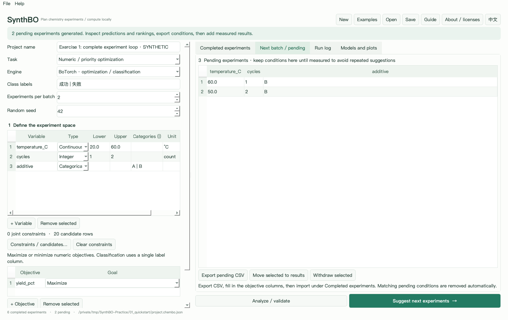

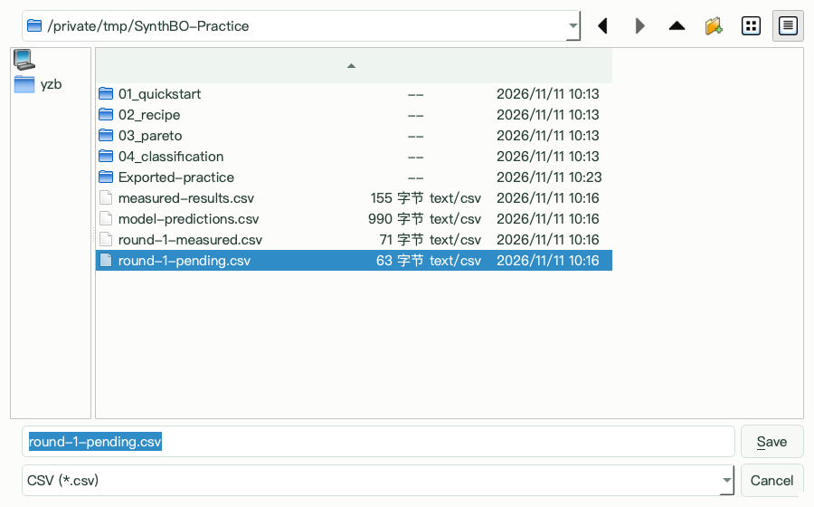

### 2.4 用模拟答案完成“做实验并回填”

这里不做真实实验，用 `all-simulated-results.csv` 模拟“测到了什么”。

1. 用 Excel 打开 `round-1-pending.csv` 和本例 `all-simulated-results.csv`。
2. 对每个待实验，按**温度、次数、添加剂三个变量共同匹配**找到完全一致的一行。
3. 只把该行的模拟 `yield_pct` 填入待回填文件。不改条件，不整表导入所有答案。
4. 把填好两行的文件保存为 CSV UTF-8 或 XLSX。
5. 回到 **已完成实验 → 导入 Excel / CSV**，导入这两条结果。
6. 检查：**已完成 8 个，待实验 0 个**。匹配的待实验会自动移除。
7. 点 **保存**，存为自己的 `quickstart-round-1.chembo.json`，再分析或生成下一批。

**不要直接用 `followup-results.csv` 回填刚生成的建议。** 它对应单独的固定待实验练习，见第 3.2 节；新推荐的条件应逐一查完整模拟答案。

一批实验没有提高最佳产率，不一定表示流程有错：模型也会选择不确定的区域以收集信息。保存每轮数据，再判断整个实验过程。


[逐步截图说明](STEP_BY_STEP.zh-CN.md)

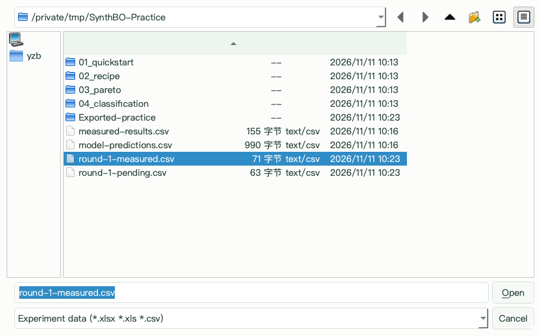

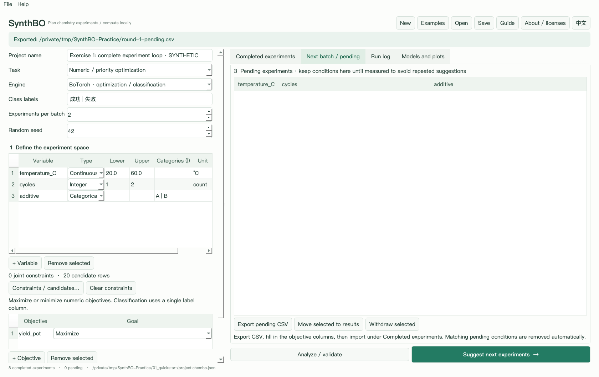

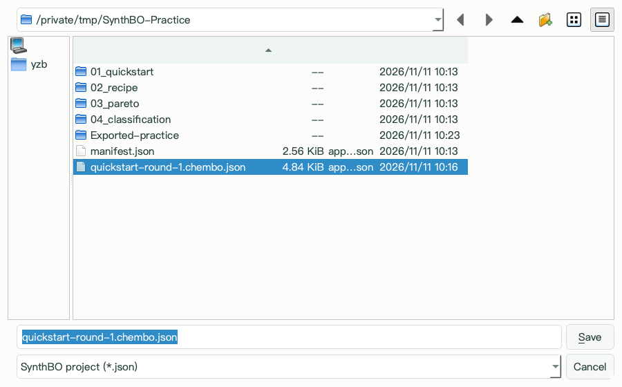

### 2.5 完成一轮后的图表示例

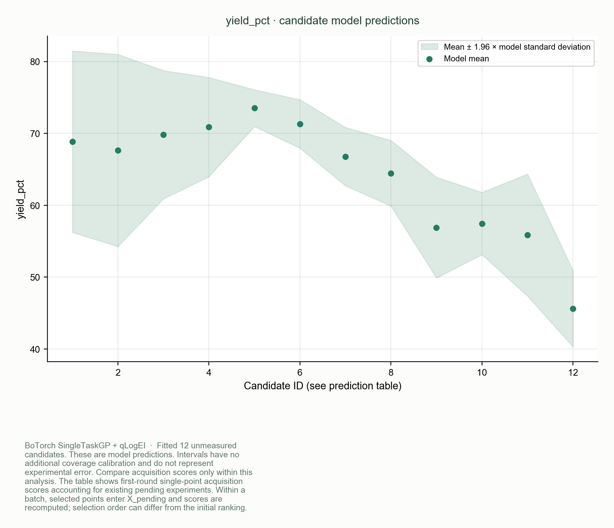

上图由应用实际使用的模型和绘图界面导出，来自**完成一轮回填后的 8 条模拟结果**，因此有 12 个未测候选，而不是初次分析的 14 个。绿色点是模型预测，浅绿色是模型区间。你的具体推荐和小数可能不同，仍按变量组合查答案、检查数量并保存项目。

## 3. 练习文件的用法

### 3.1 四套练习与检查数字

| 文件夹 | 练习内容 | 起始结果 | 全部合法候选 | 首次分析预测行数 | 生成 2 条后再分析 |
| --- | --- | --- | --- | --- | --- |
| `01_quickstart` | 单目标、三种变量、完整循环 | 6 | 20 | 14 | 12 |
| `02_recipe` | 步长、总量、配比、候选表 | 6 | 21 | 15 | 13 |
| `03_pareto` | 产率最大化、成本最小化 | 6 | 28 | 22 | 20 |
| `04_classification` | 团聚／球形／棒状 | 6，每类 2 条 | 28 | 22 | 20 |

以上数字只针对每个文件夹 `project.chembo.json` 的初始状态。顶部“教学示例”里的四个小例子是另一套数据，不套用此表的数字。

| 文件 | 用途 | 操作 |
| --- | --- | --- |
| `project.chembo.json` | 直接体验分析和推荐 | 已有 6 条，**不再导入 seed 文件**。 |
| `empty-project.chembo.json` | 练习导入 | 初始无结果，导入一种 seed 文件一次，得到 6 条。 |
| `seed-observations.csv/.xlsx/.xls` | 同一份六行数据的三种格式 | 三者任选一种，不是三批不同实验。Excel 选择 **Results** 工作表。 |
| `pending-practice.chembo.json` | 固定回填练习 | 打开为 6 个已完成、2 个固定待实验。 |
| `followup-results.csv` | 固定待实验对应的两条结果 | 只与同文件夹的 pending-practice 配对。 |
| `candidates.csv` | 允许做的变量组合 | 通过“配方约束 / 候选表…”导入，不从结果按钮导入。 |
| `all-simulated-results.csv` | 所有合法组合的模拟答案 | 查找新推荐条件，不整表导入。 |
| `README.txt`、`manifest.json` | 文件说明与检查数字 | 不作为实验结果导入。 |

Excel 中 **ReadMe** 是说明页，不是结果页。`.xls` 是真实旧版 Excel 文件，并非将 `.xlsx` 改扩展名。

### 3.2 完全固定的回填练习

四个文件夹都能这样操作：打开 `pending-practice.chembo.json`，确认 **6 个已完成／2 个待实验**；从“已完成实验”导入同文件夹的 `followup-results.csv`；应得到 **8 个已完成／0 个待实验**。

这验证“回填完整结果后自动移除匹配待实验”，不假定不同平台的优化器一定推荐同样两条条件。


[逐步截图说明](STEP_BY_STEP.zh-CN.md)

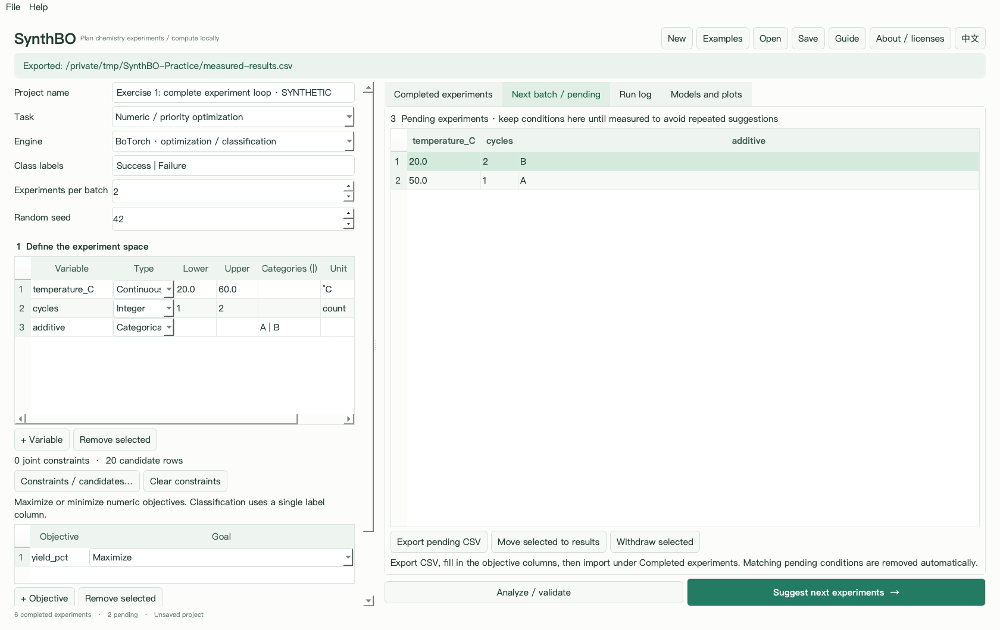

### 3.3 初始没有结果时会怎样

打开 `empty-project.chembo.json`，不导入起始数据，直接生成下一批。数值结果少于 2 条时做合法候选中的分散初始设计；分类实际只见过一个类别时也先探索，不提供虚构概率。预测图会解释尚无已拟合模型。

完成若干实验并回填后才有后验预测。练习完初始设计，应重新打开原教学项目，不把不同练习状态混在一起。


[逐步截图说明](STEP_BY_STEP.zh-CN.md)

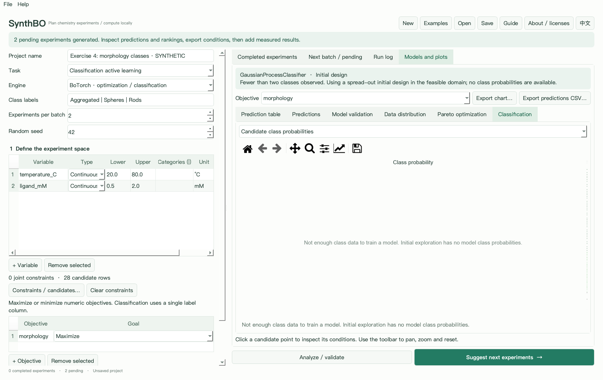

## 4. 从零建立自己的项目

### 4.1 先决定要回答什么问题

点 **新项目**，先选 **任务类型**：

| 你的问题 | 任务 | 例子 |
| --- | --- | --- |
| 一个数值越高／越低越好 | 数值优化 / 优先级，保留一个目标 | 产率最大化、粒径偏差最小化 |
| 几种性能需要权衡 | Pareto 多目标 | 提高产率并降低成本 |
| 想了解什么条件产生什么标签 | 分类主动学习 | 成功／失败、不同形貌 |
| 目标有明确先后顺序 | 数值优化 / 优先级 + Gryffin | 先关注目标 1，再考虑目标 2，见第 9 节 |

初学、需要约束和详细图表时，选 **BoTorch · 优化与分类**。这不是对不同算法效果的排名。


[逐步截图说明](STEP_BY_STEP.zh-CN.md)

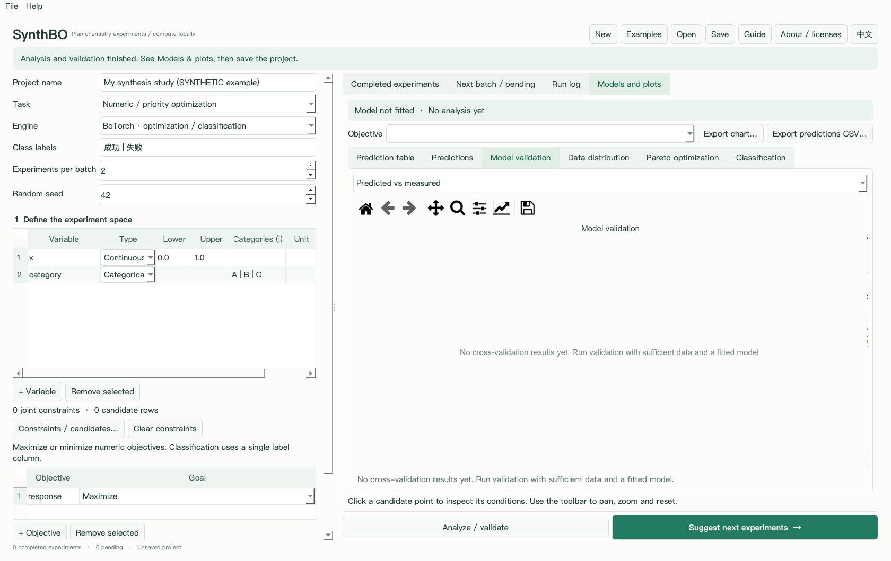

### 4.2 填写变量表

点 **＋ 变量**，填写变量名、类型、范围、类别、单位、步长：

| 设置 | 填法 | 注意 |
| --- | --- | --- |
| 变量名 | `temperature_C`、`volume_mL` 等 | 与数据表列名完全一致；变量和目标不能重名。 |
| 连续 | 实数范围，如 20–80 | 不填步长表示范围内连续取值；仪器只能按档位执行时填步长。 |
| 整数 | 如次数 1–5 | 上下限、记录和步长均须整数。 |
| 类别 | `A | B | C` | 用半角 `|` 分隔，至少两个不同类别；标签文字一致。 |
| 单位 | mL、°C、min 等 | 仅记录，不自动把 μL 换成 mL。 |
| 步长 | 0.1 mL、5 °C 等 | 从**下限**起算，下限 20、步长 7 是 20、27、34……，不强行凑上限。 |

类别不填数值上下限和步长。删除时选中变量行，点 **删除选中变量**。已有数据时先另存版本再改结构；软件不会把旧列悄悄重新命名。


[逐步截图说明](STEP_BY_STEP.zh-CN.md)

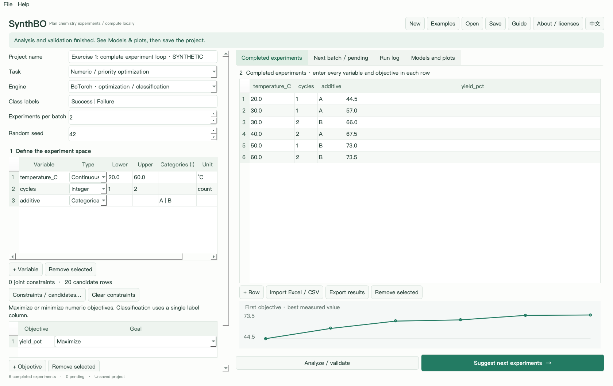

### 4.3 目标与标签

数值目标填写名称和 **最大化 / 最小化**，如 `yield_pct` 最大化、`size_error_nm` 最小化。百分数可填 73.5，但同一列别混用 0.735 和 73.5。

**＋ 目标**添加，**删除选中目标**删除。BoTorch 单目标保留一个目标，两个以上用 Pareto。分类只保留一个结果列，在 **分类标签**填 `成功 | 失败` 等；分类目标的方向不参与排序。

“容忍比例”只在 Gryffin 优先级多目标显示，是 Chimera 相对容忍设置，不是安全阈值、测量误差或“允许失败 20%”。BoTorch／Pareto 不使用它。


[逐步截图说明](STEP_BY_STEP.zh-CN.md)

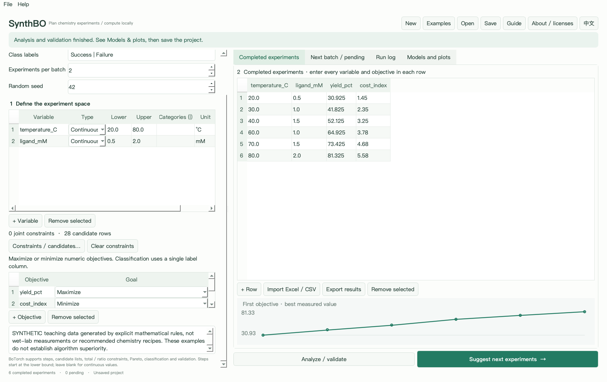

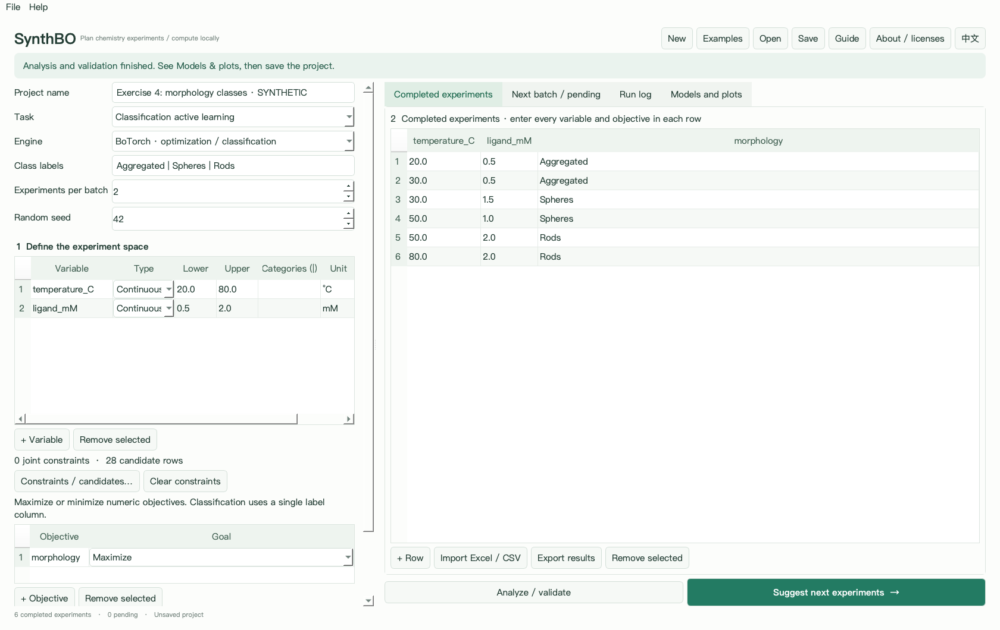

### 4.4 批量与随机种子

**本批实验数**是本次排队数量，范围 1–24。不会为凑够数量而重复已测或已排队条件。

**随机种子**帮助复现。完整项目、数据、待实验和环境相同时更容易重复计算；固定种子不承诺跨所有系统和库版本逐位相同。正式研究应保存软件版本和原始数据。


[逐步截图说明](STEP_BY_STEP.zh-CN.md)


### 4.5 录入与导入

手动：**已完成实验 → ＋ 录入一行**，填齐全部变量和目标。不能把空目标留在已完成表里；未测的条件留在待实验表。

导入：点 **导入 Excel / CSV**。表头必须**恰好**含全部变量和目标，没有额外序号、备注或单位列；列顺序可以不同，列名不能不同。单位和来源写进项目设置、备注。

练习 1 的结果表格式是：

```csv
temperature_C,cycles,additive,yield_pct
20,1,A,44.5
30,1,A,57
```

支持 UTF-8 CSV、XLS、XLSX；多工作表时选择结果所在的一张。全空白行可跳过，单个缺失单元格、重复表头会报错。Excel 公式读取已保存的数值缓存，不在应用内运行；无缓存时请用 Excel 计算保存，或粘贴为数值。

**导入追加记录，也允许重复实验。** 不按文件名去重；同一份六行文件导入两次会成 12 行。请区分真正重复测量与重复导入。


[逐步截图说明](STEP_BY_STEP.zh-CN.md)

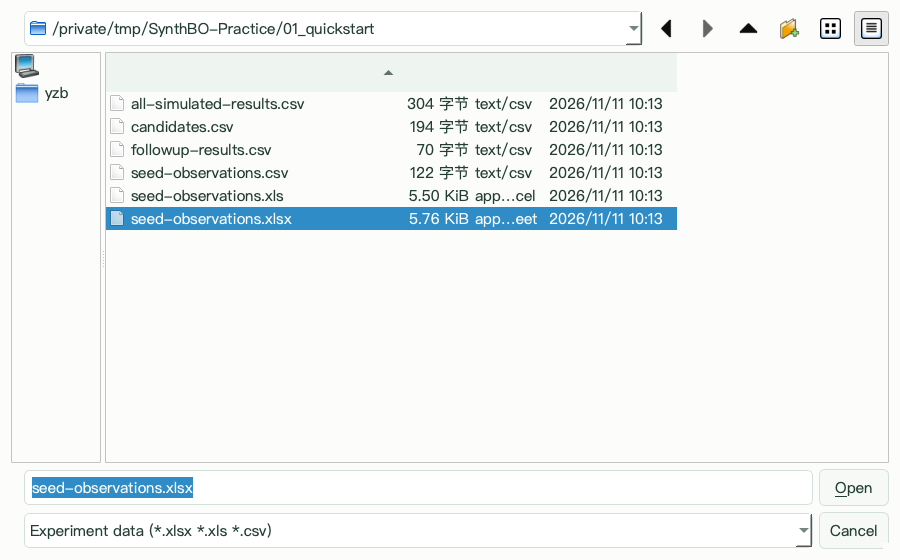

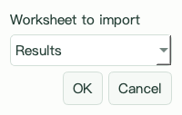


## 5. 总量、步长与合法配方

打开 `02_recipe/project.chembo.json`。假想 A、B 总量为 1 mL、A/B 在 0.25–4、老化时间只能 10/20/30 min。已有 6 条结果，合法候选 21 个。

### 5.1 规定可执行档位

变量表中 `A_mL`、`B_mL` 步长均为 0.1；`aging_min` 为整数、步长 10。建议从这些档位选择，不是在任意小数建议后随意四舍五入。


[逐步截图说明](STEP_BY_STEP.zh-CN.md)


### 5.2 添加总量或线性规则

1. 点 **配方约束 / 候选表…**。本例已有两条规则；想重建时，选中旧规则后点 **删除选中规则**。
2. 点 **＋ 总量／线性**。
3. `A_mL` 和 `B_mL` 系数填 **1**，`aging_min` 系数填 **0**。
4. 关系选 **=**，右侧填 **1**，确认。

数值变量的系数默认可能是 1，**不参与求和的变量务必改为 0**。不能直接把分钟和毫升相加。也可用 `≤`、`≥`表达预算上限或用量下限，例如 `2 × A + B ≤ 3`，各项必须量纲一致。


[逐步截图说明](STEP_BY_STEP.zh-CN.md)

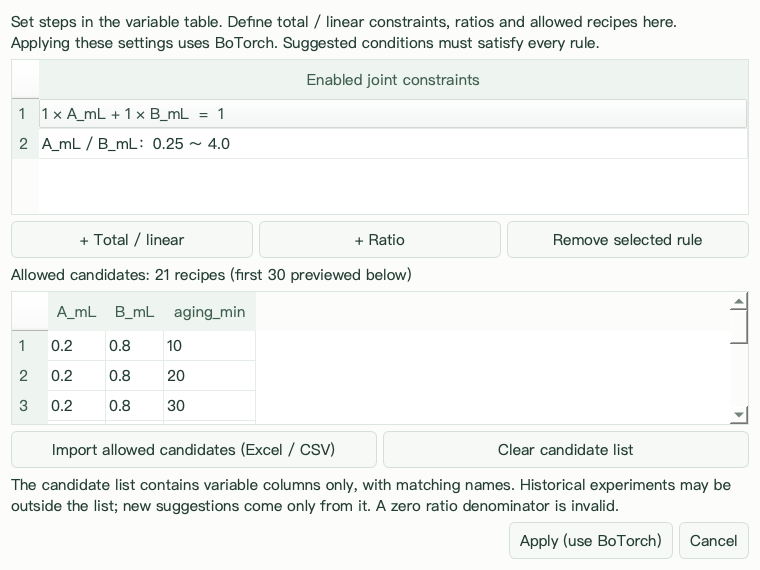

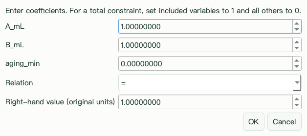

### 5.3 添加配比

点 **＋ 配比**，分子 `A_mL`，分母 `B_mL`，最小 **0.25**、最大 **4**。分母必须大于零。所有规则同时生效。


[逐步截图说明](STEP_BY_STEP.zh-CN.md)

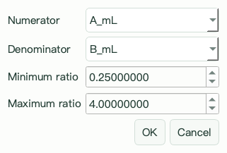

### 5.4 导入候选配方清单

点 **导入合法候选表（Excel / CSV）**，选本例 `candidates.csv`，再点 **应用（使用 BoTorch）**。该文件只有 `A_mL,B_mL,aging_min` 三列，没有目标。对话框应显示 **21 个配方**；首次分析为 **15 个未测候选**。

候选表回答“允许做什么”，结果表回答“做过什么、结果是多少”。历史结果可来自候选表外，但仍须满足边界、步长和约束；新待实验必须来自候选表。

生成两条后检查：A+B=1、0.25≤A/B≤4、体积符合 0.1 档位、时间为 10/20/30。若实验实际执行了不同条件，应按真实执行值回填，不篡改真实数据以匹配建议。

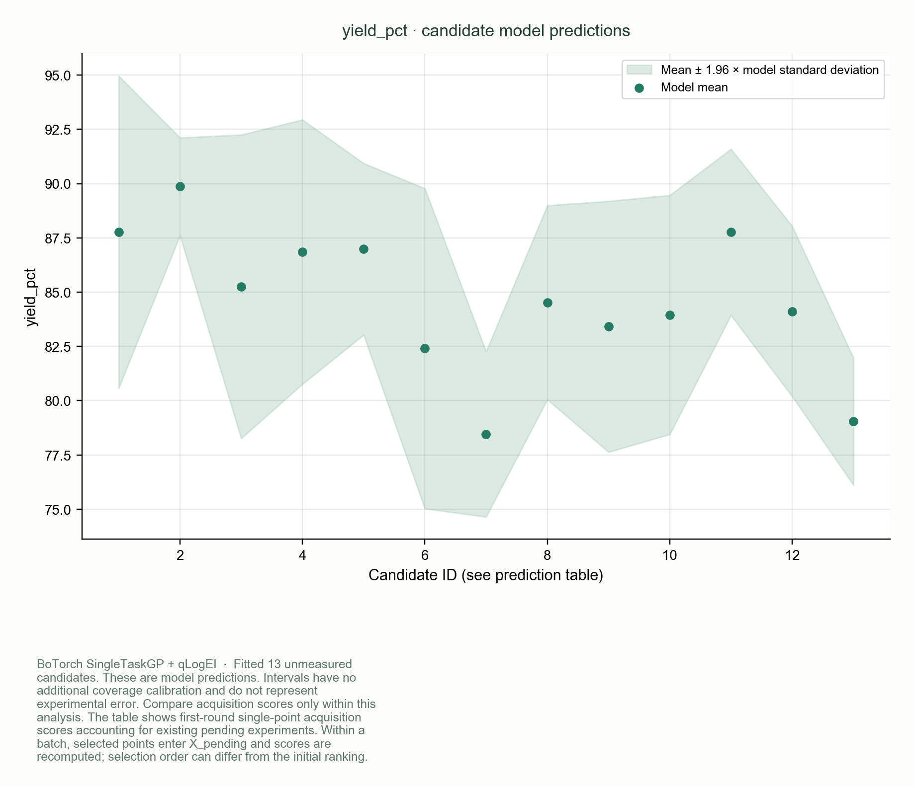

本图由应用对**6 条模拟结果**拟合后实际导出。21 个合法配方中有 6 个完成、2 个待实验，图中比较其余 13 个候选；它们的总量、配比和步长仍受同一组规则约束。预测值不是真实测得的产率。


[逐步截图说明](STEP_BY_STEP.zh-CN.md)

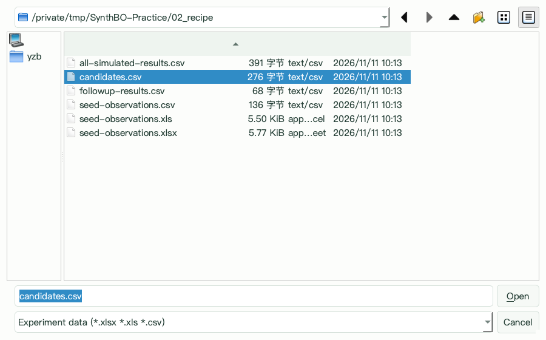

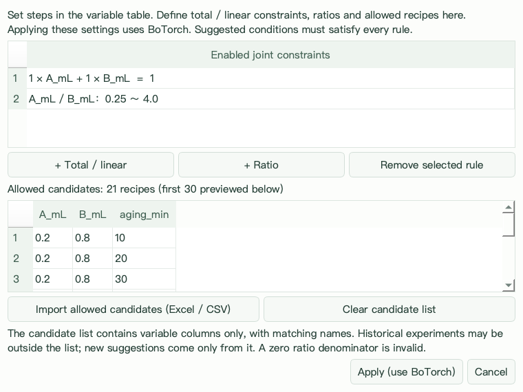

### 5.5 修改或清除

删除单条规则用 **删除选中规则**；只移除候选表用 **清除候选表**。主窗口 **清除联合限制**同时移除联合约束和候选表，**不会清空变量步长**。

本例即使清掉候选表，仍可由范围／步长和规则生成 21 个合法组合。改规则后若旧结果不合法，先保留旧项目、核对实际实验，再建立适当新项目，不能改写真实记录来通过校验。

有限域最多检查 200,000 组源组合，一次排序最多 4,096 个合法未做候选。大空间可增加步长或用实验室预筛选清单；排名只针对这次实际评分的候选池。连续域可能只采样一个可行子集，不表示已找到全局最优。


[逐步截图说明](STEP_BY_STEP.zh-CN.md)


## 6. Pareto 多目标

### 6.1 保留性能折衷

打开 `03_pareto/project.chembo.json`，6 条模拟结果、0 条待实验。任务为 **Pareto 多目标**、引擎 BoTorch；`yield_pct` 最大化、`cost_index` 最小化（无量纲模拟成本）。

点 **分析与交叉验证**，预测表应有 **22 行**。顶部 **查看目标**可切换产率／成本，分别看预测与验证。

进入 **Pareto 多目标 → 二维 Pareto**，X 选 `yield_pct`，Y 选 `cost_index`。绿色是全目标下的非支配已测点：没有另一个已测条件在所有方向上都不差、并至少一个方向更好。灰色是其他已测点。未测预测、待实验不进入实测前沿。

Pareto 帮助比较折衷，不自动决定最终配方；研究者仍需考虑可放大性、测量可靠性、预算等。

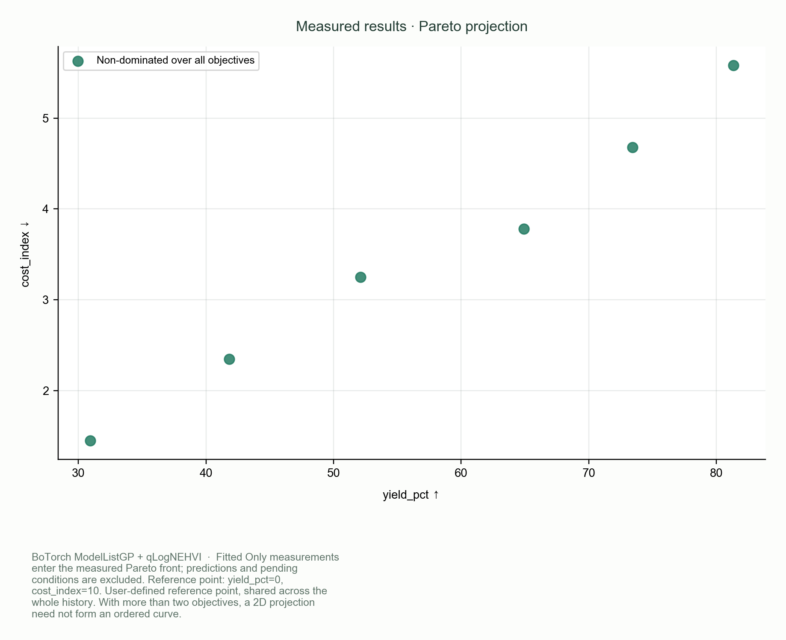

这是本练习实际模型分析与应用绘图界面输出的**6 条模拟结果**。横轴产率向右更好，纵轴成本向下更好，绿色点保留不同折衷；若存在其他非前沿结果，则显示为灰色。图中的“实测”表示项目已完成结果栏，数据来源仍全部为 SYNTHETIC，不是湿实验。


[逐步截图说明](STEP_BY_STEP.zh-CN.md)

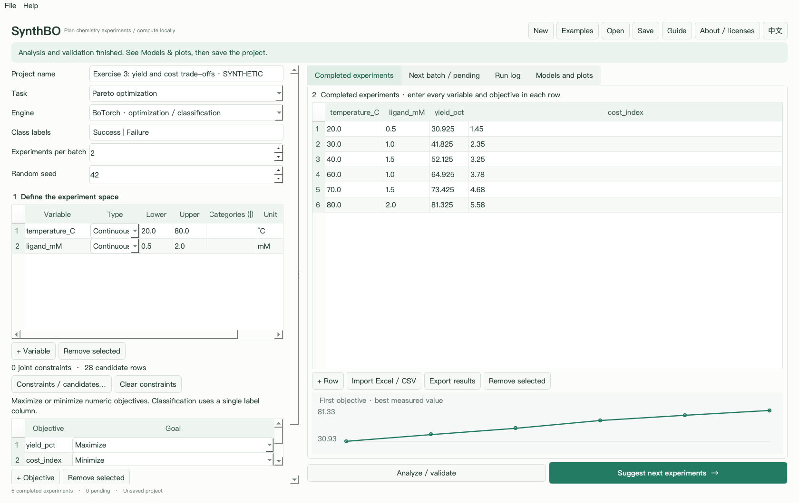

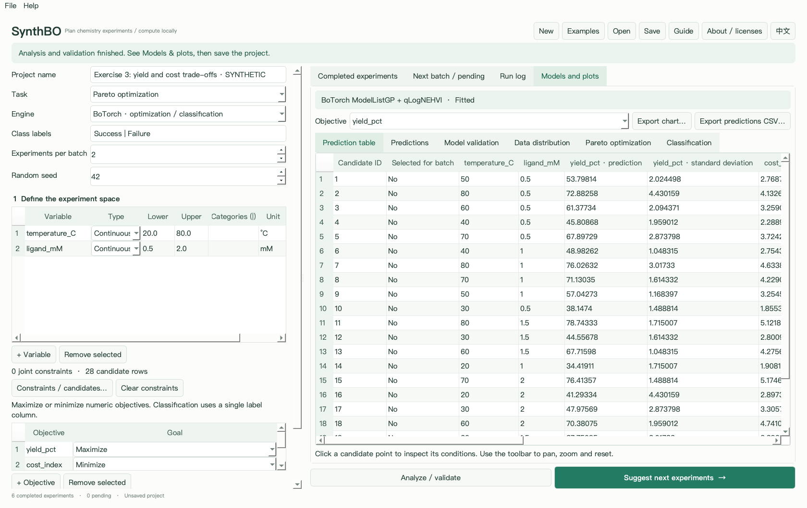

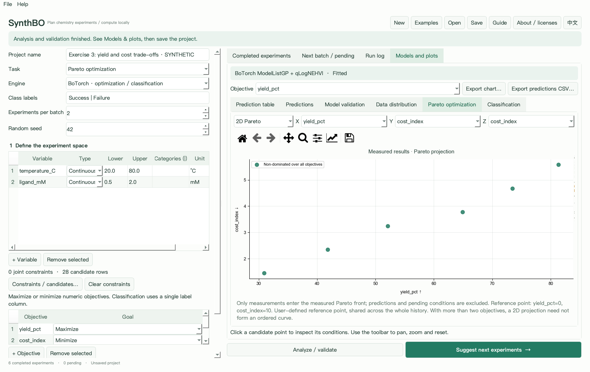

### 6.2 超体积历史

同页选择 **超体积历史**。本例固定参考点为 `yield_pct=0,cost_index=10`，表示同一标准下已测折衷方案覆盖的目标空间；参考点不是一条测量结果。

一般项目默认参考点会随本次数据变化，跨轮比较绝对超体积应使用相同参考点。当前 GUI 没有单独的参考点输入框；教学项目已预置，无需初学者编辑 JSON。


[逐步截图说明](STEP_BY_STEP.zh-CN.md)

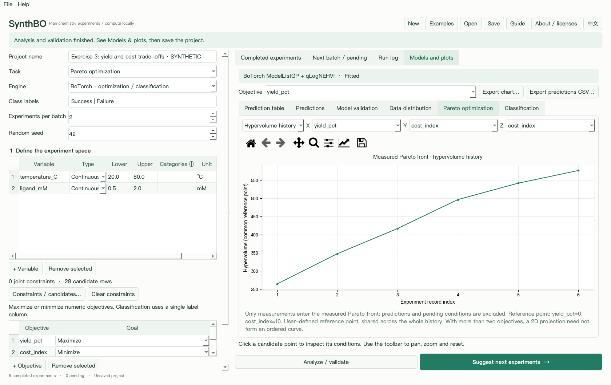

### 6.3 三维 Pareto

打开 `three-objective-project.chembo.json`，额外包含要最小化的 `waste_index`，已有 6 条完整三目标结果。分析后选择 **三维 Pareto**，X/Y/Z 分别选 `yield_pct/cost_index/waste_index`，即可查看和导出。

三维需要三个不同目标，二目标项目不能凭空产生第三目标。三目标回填必须填齐三个结果，可查 `three-objective-all-simulated-results.csv`；不能导入只有两个目标的起始表。三个以上目标的二维投影，不一定形成直观的有序曲线。


[逐步截图说明](STEP_BY_STEP.zh-CN.md)

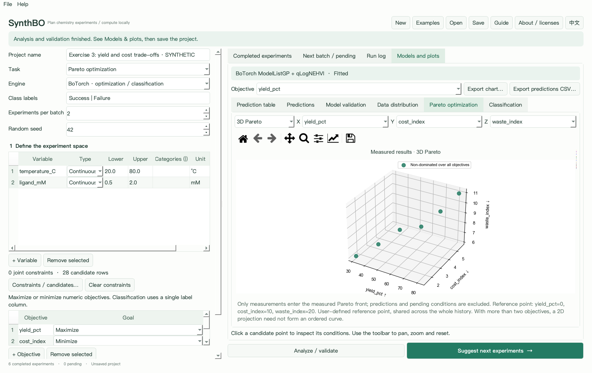

## 7. 分类主动学习

### 7.1 探索文字标签

打开 `04_classification/project.chembo.json`，标签为 `团聚 | 球形 | 棒状`，唯一结果列为 `morphology`。已有 6 条，每类 2 条。

点 **分析与交叉验证**，候选表应有 **22 行**，显示 `P(团聚)`、`P(球形)`、`P(棒状)`和“熵”。在 **分类分析**查看：

| 图形 | 含义 |
| --- | --- |
| 候选类别概率 | 同一候选的已观察类别概率加和为 1。图显示前 40 个候选，完整信息在表格。 |
| 分类不确定性 | 熵越高，模型越拿不准；本策略优先探索这样的条件。 |
| 已测类别分布 | 当前已完成记录的类别计数，本例初始 2、2、2。 |
| 混淆矩阵 | 行是留出记录的实际类别，列是预测类别；对角线上是预测正确的次数。本例累计 6 个留出预测。 |

生成 2 条后，用完整模拟答案查找变量组合，回填一个允许的完整标签。不要把概率或“80% 球形”填进结果列。

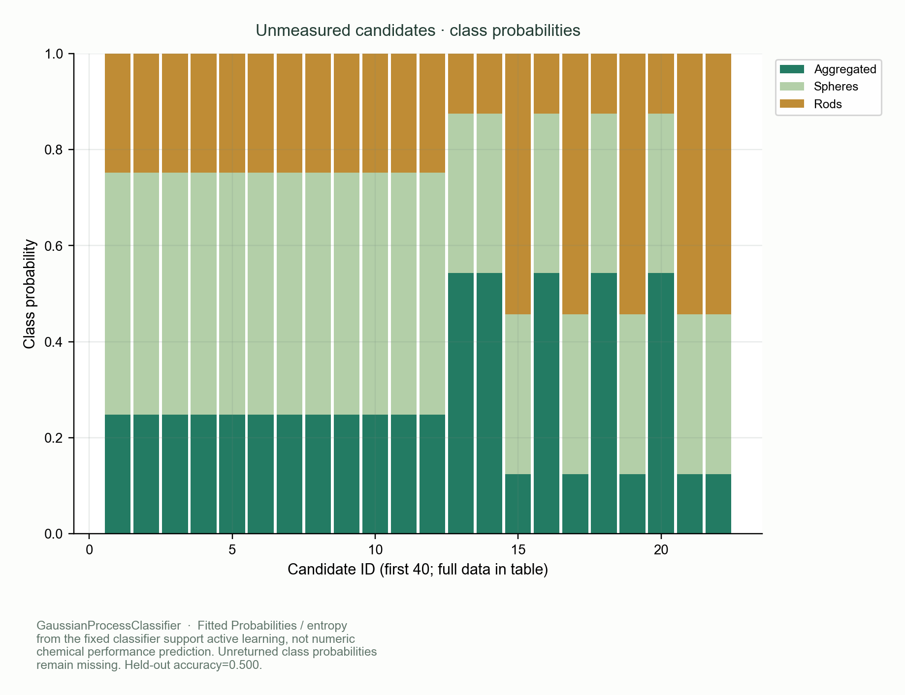

本图来自实际分类器对**6 条模拟标签**的分析，剩余 22 个未测候选。每根柱子表示一个候选在三种已见类别之间的概率分配；你的下一批条件可能不同，应读取自己项目中的完整预测表。

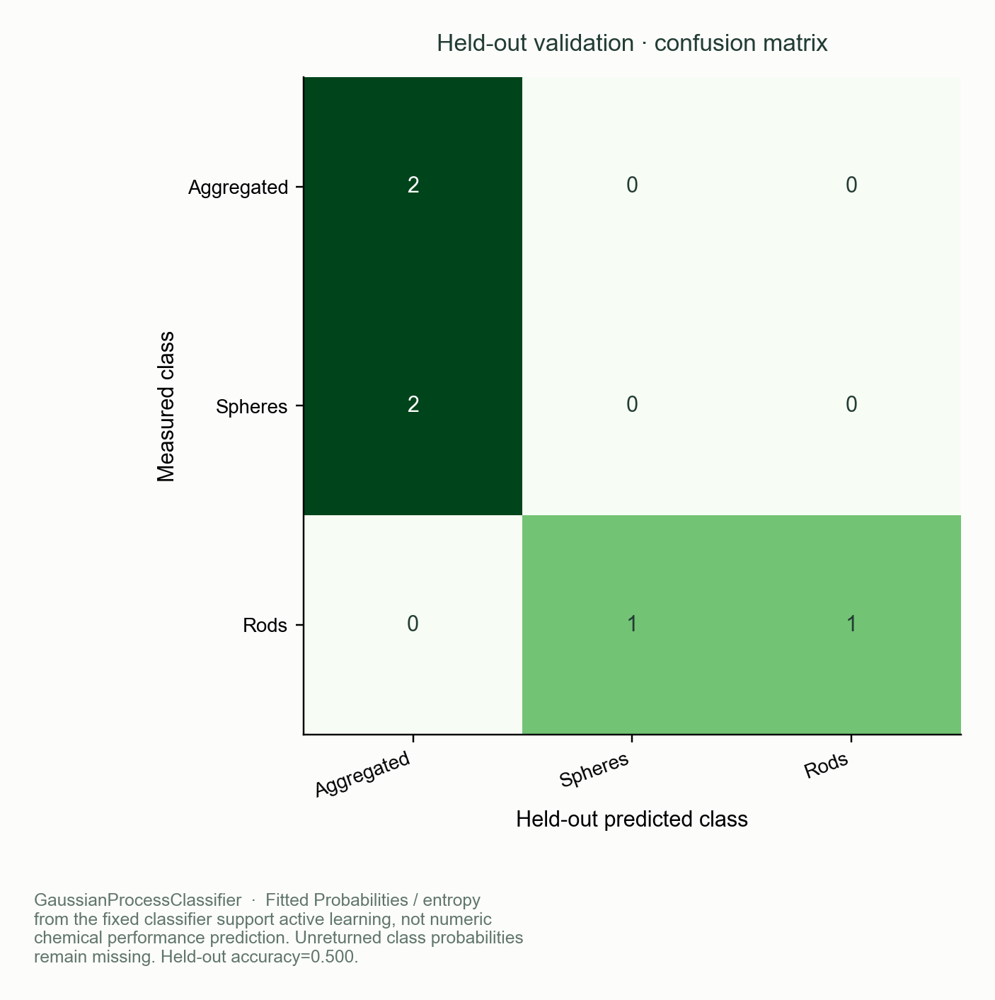

同一次分析的混淆矩阵共有 6 个留出预测，对角线上是 3 个，因此本图准确率为 3/6，即 0.500。它直观展示了哪些形貌容易被分错，不应只看一个总体准确率；这里的“实测类别”仍指教学项目中填入的模拟标签。


[逐步截图说明](STEP_BY_STEP.zh-CN.md)


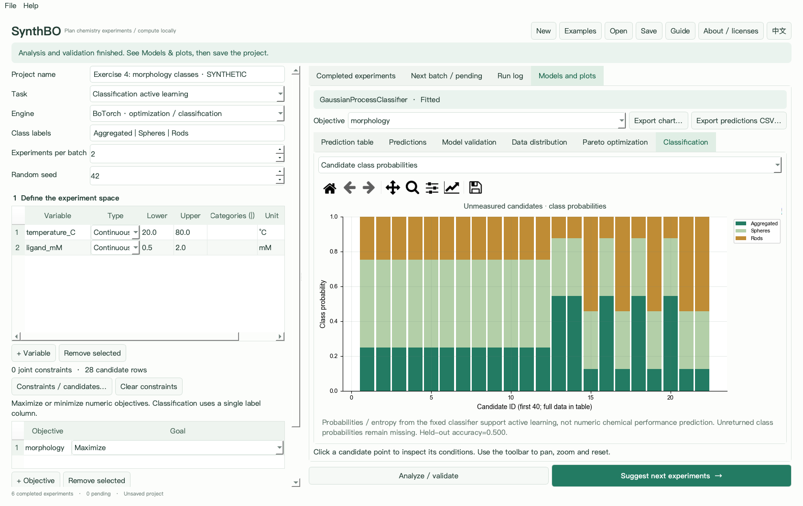

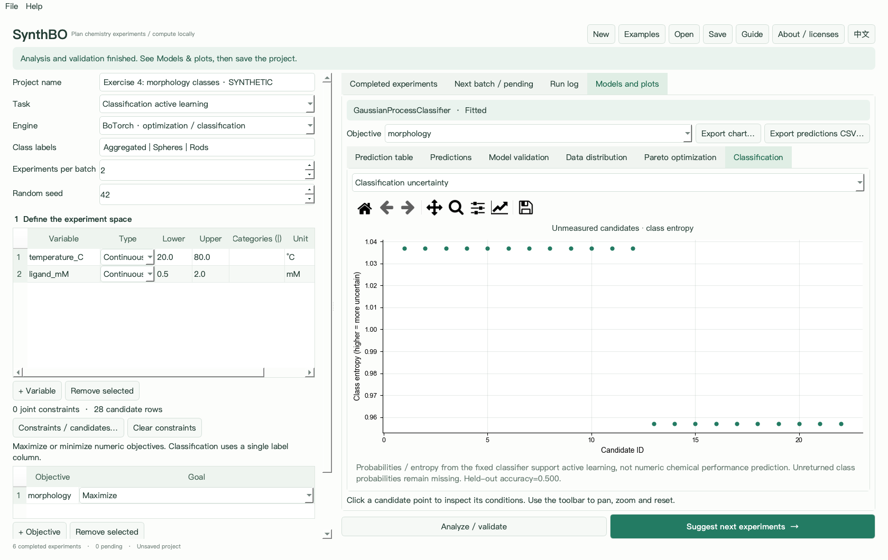

### 7.2 成功／失败

打开同文件夹 `binary-project.chembo.json`，标签改为 `成功 | 失败`，结果列为 `outcome`，已有 6 条结果；答案查 `binary-all-simulated-results.csv`。

本分类策略按**不确定性**选点，帮助了解类别边界，不是优先选择最可能成功的条件。要最大化连续产率应选择数值任务。


[逐步截图说明](STEP_BY_STEP.zh-CN.md)

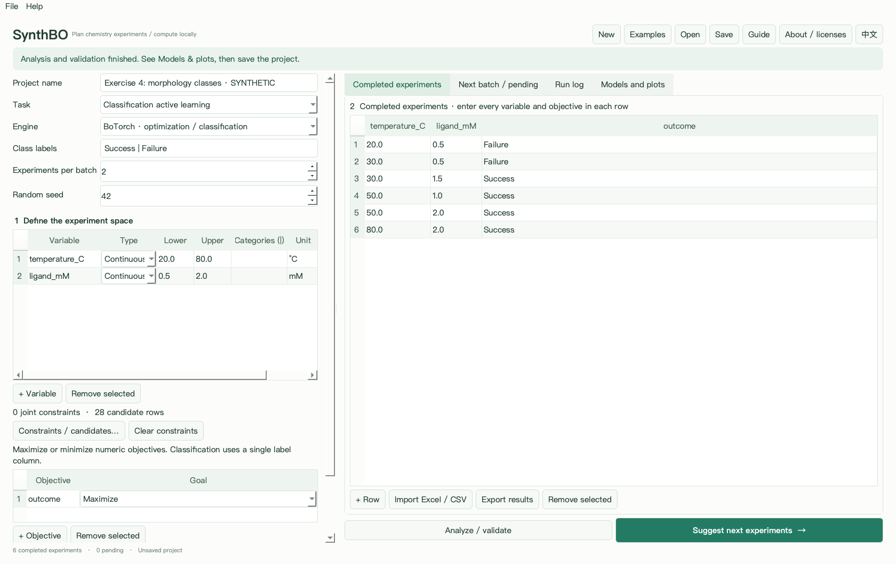

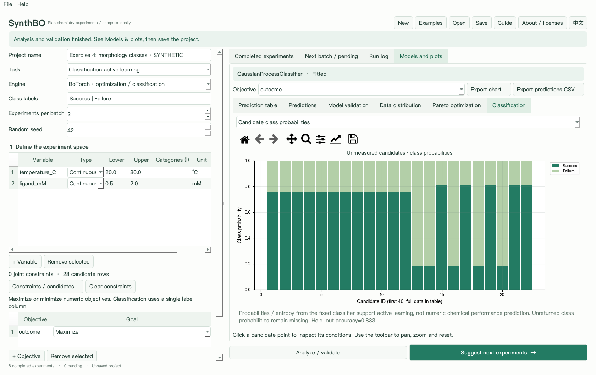

### 7.3 类别不够时

至少预定义两个标签，实际数据见到两个类别后才拟合分类器。只见过一个类别时先初始探索，不给虚假概率。预定义但未观察过的类别保持缺失，不补为 0%；当前概率只在见过的类别间归一化。

分类留一后若训练集只剩一个类别，该折跳过并显示实际验证数量。少量样本的准确率不能替代独立实验确认。


[逐步截图说明](STEP_BY_STEP.zh-CN.md)


## 8. 读懂模型与可视化

**生成下一批实验**会排队条件；**分析与交叉验证**只拟合和诊断，不增加待实验。Gryffin／Atlas 保留原生推荐，没有用另一个模型冒充它们的后验诊断。

### 8.1 候选预测表

点表头可数值排序。每行包含实际变量条件；数值任务显示均值／标准差，分类显示概率／熵。

采集分值表示**本次计算中值得尝试的程度**，不是产率或成功率，也不跨两次计算比较绝对值。批次依次选择时会把刚选中的点加入待实验后重评分，因此“本批推荐”不一定是首轮排名的前两条。


[逐步截图说明](STEP_BY_STEP.zh-CN.md)


### 8.2 预测与探索

| 选项 | 回答什么问题 | 如何理解 |
| --- | --- | --- |
| 候选预测与区间 | 哪些条件预计较好，哪里不确定？ | 色带为均值±1.96×模型标准差，未校准覆盖率，不表示实验测量误差；金色星号为本批推荐。 |
| 预测均值与不确定性 | 高预测与高不确定的点分别在哪？ | 横轴均值、纵轴模型标准差；不确定性高不保证性能高。 |
| 采集分值排序 | 这次候选的优先级如何分布？ | 同一次分析内比较。 |

点击候选散点，下方显示对应变量组合。工具栏支持平移、缩放、还原。


[逐步截图说明](STEP_BY_STEP.zh-CN.md)

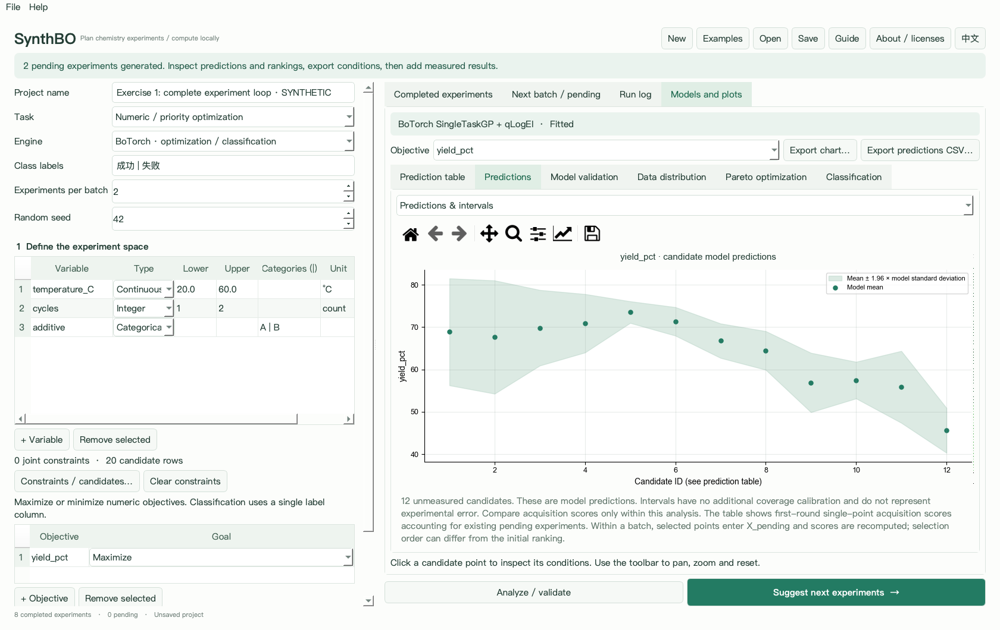

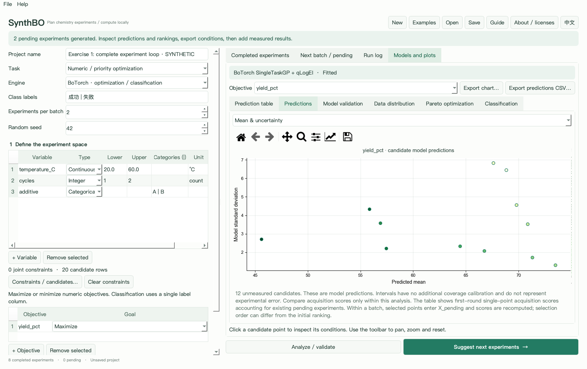

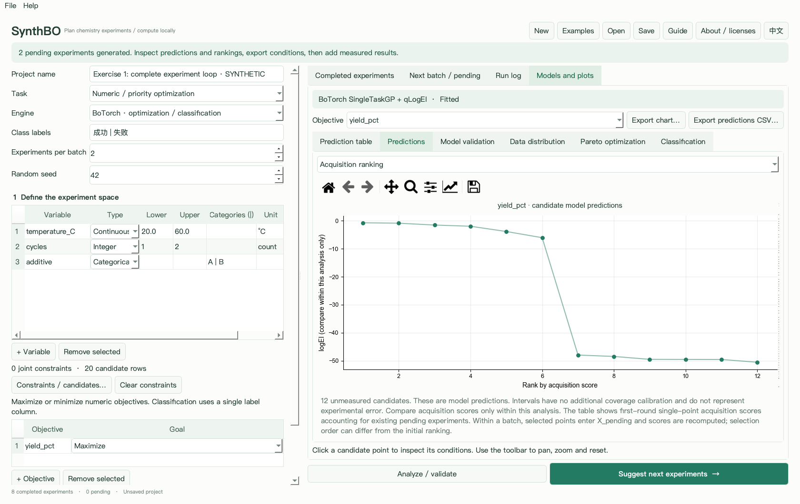

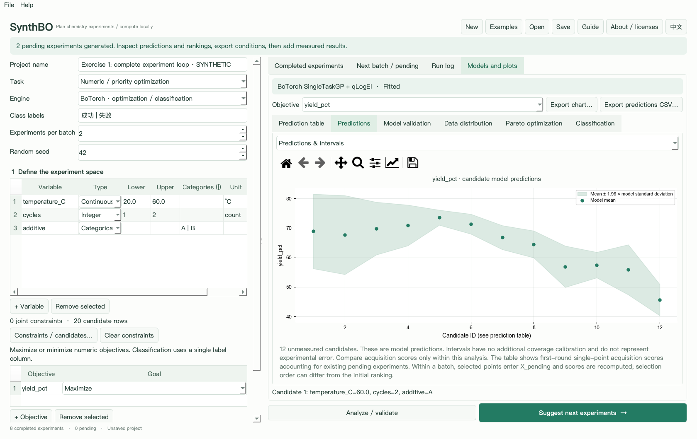

### 8.3 模型验证

点 **分析与交叉验证**后，在 **模型验证**选择：

- **预测与实测**：每条记录拿走一次，用其余记录重新训练同一个实际模型再预测它；点越接近对角线越一致。
- **验证误差**：显示“预测−实测”，方便检查偏高、偏低和个别大偏差。
- **RMSE**：均方根误差，对大偏差更敏感。
- **MAE**：平均绝对误差，与原目标同单位。
- **R²**：相对于当前数据均值的比较指标，可为负；实测值全相同时不报告。

至少 3 条才能留一；超过 30 条时均匀选最多 30 条分别留出，每折仍用其余全部记录训练。分类验证在“分类分析 → 混淆矩阵”，不在数值散点。留一检查当前数据的预测能力，不替代独立真实实验。

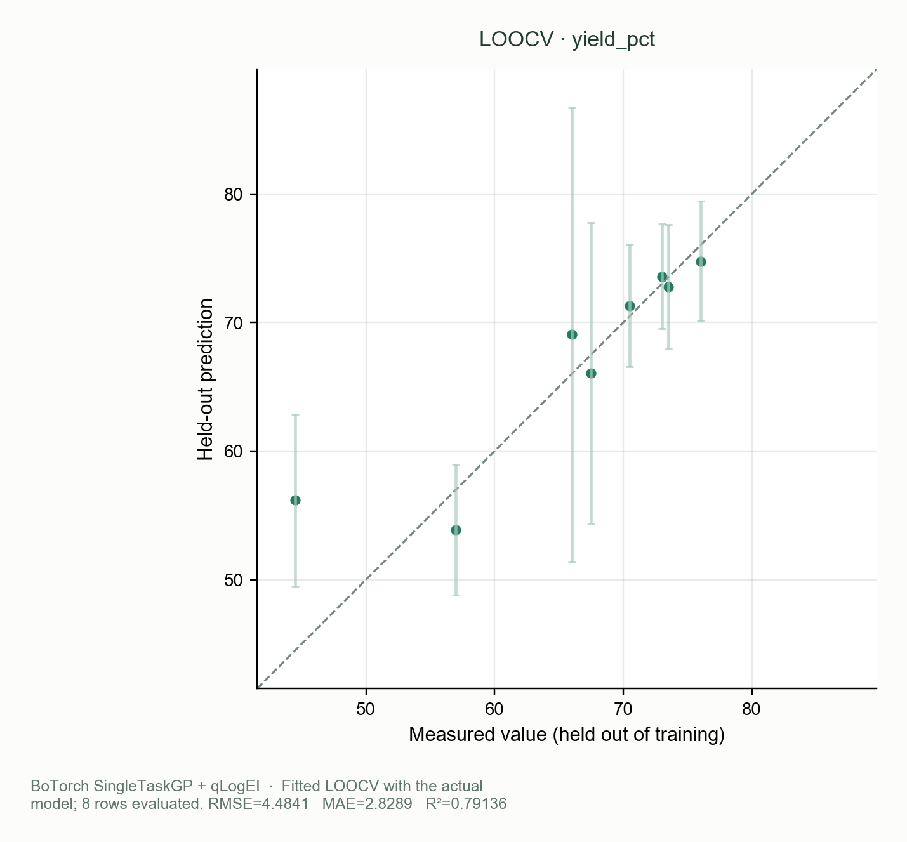

本图由应用实际留一重拟合并导出，使用**8 条模拟结果**。横轴是被留出记录中的模拟产率，纵轴是没有用到该记录时的预测；例如图中 RMSE 约 4.48，按本例尺度可读作约 4.48 个产率百分点。误差条是模型不确定性，不是仪器重复测量误差；你的数据和留出指标可能不同。


[逐步截图说明](STEP_BY_STEP.zh-CN.md)


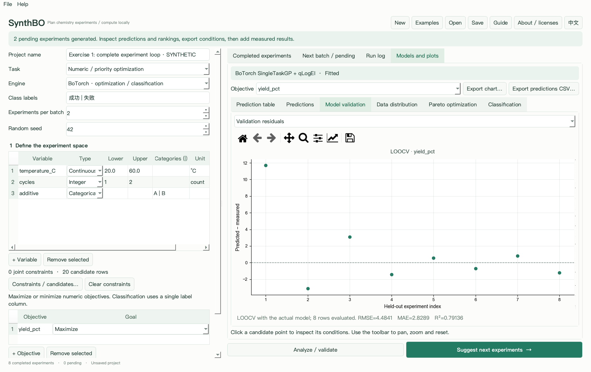

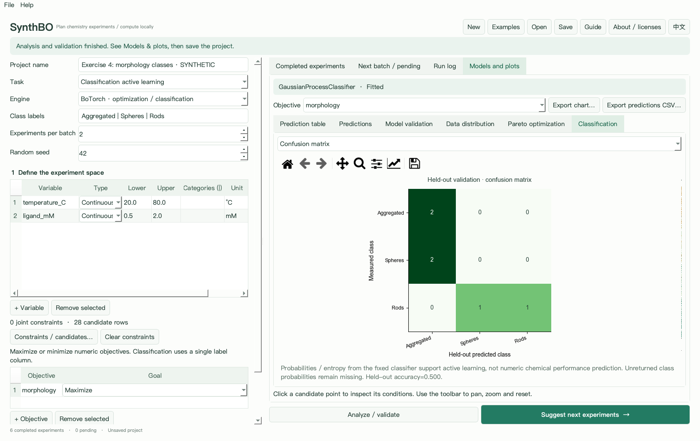

### 8.4 分布与历史

**数据分布**里选择变量，再选 **观测分布 / 实测历史**。数值显示直方图，类别显示计数；查看数值目标历史时还显示对应方向的历史最佳值。主窗口趋势只画首个数值目标，分类不显示该数值曲线。

只统计已完成记录，包含重复实验；记录序号不等于实际时间间隔。


[逐步截图说明](STEP_BY_STEP.zh-CN.md)

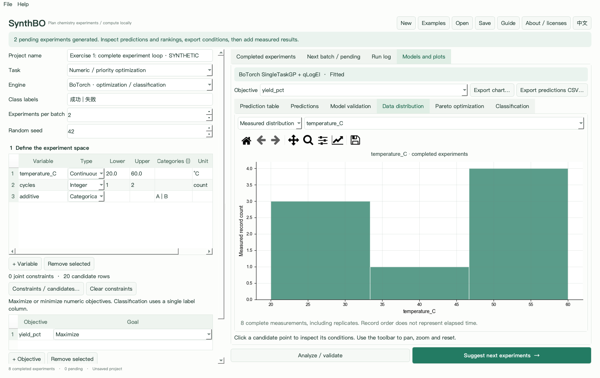

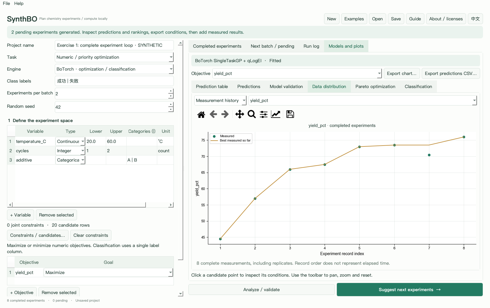

### 8.5 导图与导表

先选所需图，再点 **导出当前图…**，选择 **PNG / PDF / SVG**。PNG 便于幻灯片，PDF/SVG 保留矢量信息。导图附带模型状态和说明，帮助区分预测和实测。

**导出预测表 CSV…**保留全部候选，不只是屏幕能看到的行。在候选表页点“导出当前图”会导出数值预测图，分类项目则导出分类图，不是表格截图。

应用提供单张图、预测 CSV 和项目导出，没有“一键完整论文报告”按钮。汇报时组合所需图、已测结果、备注与引用信息；预测 CSV 不能作为实测结果导入。


[逐步截图说明](STEP_BY_STEP.zh-CN.md)

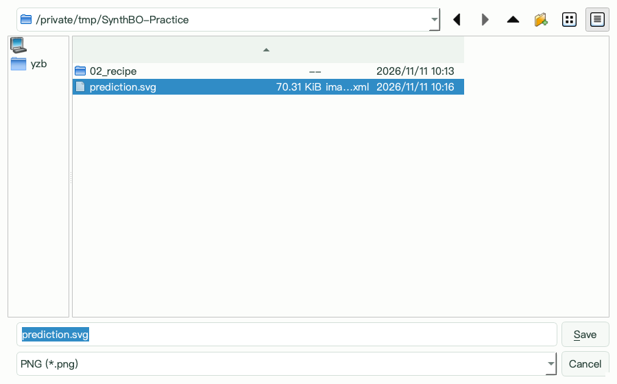

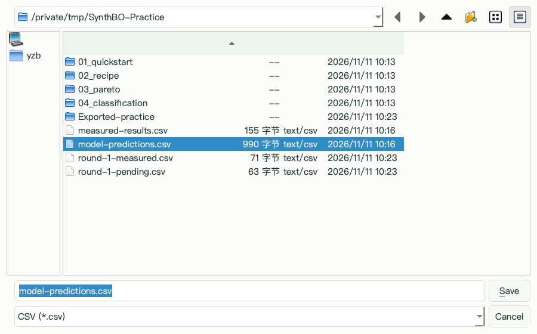

## 9. Gryffin、Atlas 与引擎选择

### 9.1 按任务选择

| 需求 | 选择 | 本版范围 |
| --- | --- | --- |
| 四套教学练习、约束配方、Pareto、分类、详细图表 | BoTorch · 优化与分类 | 数值固定 GP，分类固定概率分类器，无需选择额外模型菜单。 |
| Gryffin 原生连续／整数／类别推荐、先后顺序目标 | Gryffin · 类别与连续变量 | 原生推荐，多目标用 Chimera；没有 BoTorch 后验诊断。 |
| Atlas 原生单目标与批量 | Atlas · 高斯过程 | 原生 GPPlanner；描述符、多保真、元学习等尚未开放为用户功能。 |

没有 GP／随机森林／SVM 或 EI／UCB 的切换菜单。步长、联合规则、显式候选、Pareto、分类走 BoTorch；不兼容组合会提示，不静默换算法。

练习 1 的 `gryffin-project.chembo.json`、`atlas-project.chembo.json`保留 6 条模拟记录，去掉步长和显式候选。打开即可体验原生推荐。它们可能给出完整答案表之外的连续数值，不能四舍五入去冒充已知结果。需要第 8 节诊断时，重新打开 BoTorch 项目。


[逐步截图说明](STEP_BY_STEP.zh-CN.md)


### 9.2 Gryffin 的优先级

Gryffin 选择“数值优化 / 优先级”时，目标自上而下为优先顺序。容忍比例是 Chimera 相对设置，不能直接读成绝对化学阈值。想保留“高产率／低成本”的折衷时，可按第 6 节使用 Pareto。

切换引擎不删除原始记录，但应按新设置重新计算模型，不能直接比较不同引擎的分值。方法归属见[引用指南](HOW_TO_CITE.md)与[公开致谢](../ACKNOWLEDGMENTS.md)。


[逐步截图说明](STEP_BY_STEP.zh-CN.md)


## 10. 保存、导出与项目记录

### 10.1 项目和表格各管什么

| 入口 | 内容 | 使用时机 |
| --- | --- | --- |
| 保存／文件 → 保存项目 | 变量、目标、规则、候选、结果、待实验、历史、最近分析、备注 | 每次导入、推荐、分析后保存，完整继续项目。 |
| 文件 → 项目另存为… | 独立项目副本 | 每轮前后或更改结构前。 |
| 已完成实验 → 导出结果 | 变量和已测目标 CSV | 交给同事核对或另行分析。 |
| 下一批 / 待实验 → 导出待回填 CSV | 变量和空目标 CSV | 安排实验、填写结果。 |
| 模型与可视化 → 导出预测表 CSV… | 候选均值、标准差／概率、分值等 | 解释推荐依据，不能当实测导入。 |

Mac：⌘N 新建、⌘O 打开、⌘S 保存、⌘⇧S 另存。Windows 使用 Ctrl 对应组合。项目 `.chembo.json` 是数据文件，不要求使用者编程。

标题前圆点表示未保存修改。切换项目、示例或关窗时会询问保存、放弃或取消。点击推荐不会自动把项目数据上传 GitHub。


[逐步截图说明](STEP_BY_STEP.zh-CN.md)


### 10.2 手动转入、撤回与重复实验

在待实验表选中条件，点 **将选中条件转入结果表**，变量复制到结果表的空目标行。立即填齐结果，再保存或计算；通过完整结果校验后，对应待实验移除。

不打算做的条件选 **撤回选中条件**。撤回不产生测量值，该条件以后可能再被推荐，不要随便填 0 代替撤回。

**删除选中行**移除误录结果；真实重复实验可保留。改删结果会影响模型，并不自动留一份被删行快照，正式数据先另存版本。


[逐步截图说明](STEP_BY_STEP.zh-CN.md)


### 10.3 计算、日志与取消

计算时编辑控件暂时禁用，进度条表示工作中，不是已完成百分比。**运行日志**显示状态；**取消计算**停止当前计算，原始实验记录保留，未完成计算不冒充新结果。

改数据、目标、空间或规则后，旧分析失效并清空，需要重新分析。空图不等于数据丢失，先检查已完成数量和页面说明。

正式研究每轮保留独立项目、原始仪器数据、已测 CSV、软件版本和随机种子。真实单位、表征方法、标签标准写进备注。


[逐步截图说明](STEP_BY_STEP.zh-CN.md)


## 11. 常见问题

| 现象 | 原因与处理 |
| --- | --- |
| 列名不一致 | 去掉额外编号／备注，补齐全部变量和目标；先用空教学项目导入六行表练习。 |
| 中文乱码 | CSV 另存为 UTF-8，或直接导入 XLSX。 |
| Excel 公式显示缺失 | 用 Excel 计算保存缓存，或粘贴为数值；应用不执行公式。 |
| 未知分类标签 | 按项目统一文字，新增标签前保留旧版本并检查全部记录。 |
| 不在允许档位 | 核对下限和步长：下限 0.1、步长 0.2 不包括 0.2；不能随意改真实记录来过校验。 |
| 没有合法配方 | 检查量纲、系数、边界、比例和清单是否矛盾；配比的分母须大于 0。 |
| 候选只剩 1 个，却要 2 个 | 降低本批数量，先完成待实验，或有依据地扩展范围。 |
| 预测图为空 | 初始设计、尚未训练，或经典引擎没有这套诊断；读页面说明，BoTorch 下回填后分析。 |
| 没有留一结果 | 至少 3 条，点击分析；分类还需足够类别，部分折可能被跳过。 |
| 图表突然消失 | 设置或数据改变使旧分析过期，重新运行分析。 |
| 六行变成十二行 | 同一起始文件重复导入，检查并删除误导入副本。 |
| 回填后待实验没消失 | 比较全部变量组合，不只温度；不要改写推荐的小数。固定练习要配对应 followup 文件。 |
| 长时间计算或失败 | 首次启动、复杂数据或训练错误；看日志，需要时取消并保存。失败会报错，不伪装有效推荐。 |
| 提示 BoTorch 组件缺失 | 获取完整安装包，日常用户不需要自行拼装 Python 环境。 |
| Windows 是否通过实机验证 | 查看对应安装包的 Windows 验收记录。Hotfix1 修复了原 0.2.3 测试包的模型兼容性问题；Mac 验证不代替 Windows 验证。 |

报告问题时写明版本、系统／架构、任务／引擎、按钮和错误文字。能用模拟教学项目复现时，优先提供这一操作顺序，不公开保密配方、原始敏感数据、密码或令牌。

**关于 / 许可**显示版本和方法范围，并可打开随附许可证目录。开源界面不改变原模型作者归属；发表研究时请按实际使用的方法[引用原始论文与软件](HOW_TO_CITE.md)。

## 12. 完整功能索引

| 需求 | 入口 | 对应章节 |
| --- | --- | --- |
| 中英文离线教程、复制练习文件 | 帮助菜单 | 1 |
| 内置四个模拟小例子 | 教学示例 | 2–3；检查数字与文件练习不同 |
| 新建、打开、保存、另存 | 顶部／文件菜单 | 4、10 |
| 连续／整数／类别、单位、步长 | 变量表 | 4–5 |
| 目标方向、目标增删 | 目标表 | 4、6 |
| 批次、种子、备注 | 左侧设置 | 4、10 |
| 总量／线性、比例、候选表、清除规则 | 配方约束 / 候选表… | 5 |
| 手动录入、XLS/XLSX/CSV、选工作表 | 已完成实验 | 3–4 |
| 结果导出、删误录、重复实验 | 已完成实验 | 10 |
| 下一批、排除已测／待实验重复 | 生成下一批实验 | 2 |
| 待实验导出、手动转入、回填、撤回 | 下一批 / 待实验 | 2、3.2、10.2 |
| 预测、标准差、分值、排序 | 模型与可视化 | 8.1–8.2 |
| 留一、RMSE、MAE、R² | 模型验证 | 8.3 |
| 数值分布、类别计数、最佳历史 | 数据分布 | 8.4 |
| 二／三维 Pareto、目标轴、超体积 | Pareto 多目标 | 6 |
| 二／多分类、概率、熵、混淆矩阵 | 分类分析 | 7 |
| 点选、平移、缩放、还原 | 图表工具栏 | 8 |
| PNG/PDF/SVG、完整预测表导出 | 图表导出按钮 | 8.5 |
| Gryffin／Atlas 原生、Chimera 优先级 | 推荐引擎／任务 | 9 |
| 日志、取消、分析过期 | 运行日志／取消计算 | 10.3、11 |
| 版本、许可、引用 | 关于 / 许可 | 11 |

计算边界详见 [V0.2_FEATURES.md](V0.2_FEATURES.md)，开发构建见 [DEVELOPMENT.md](DEVELOPMENT.md)。日常使用只需安装应用、准备清楚的实验表，并保存每轮项目。

[逐步截图说明](STEP_BY_STEP.zh-CN.md)


