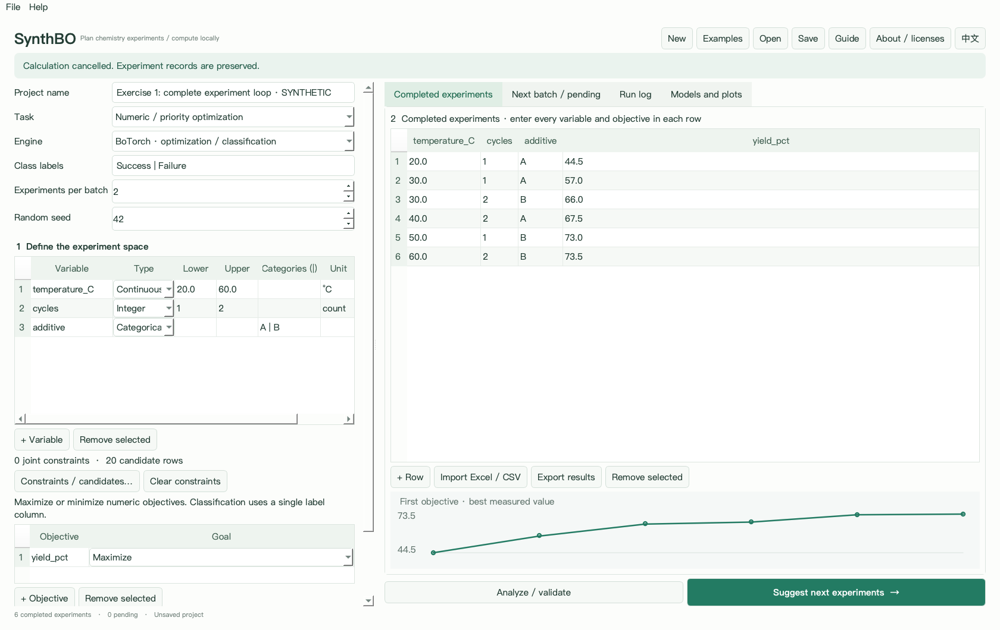

# SynthBO 使用说明

新版教程已整理为可以逐步操作的中英文版本，并配套完整模拟练习数据。

- [中文完整教程：跟着模拟实验学会规划下一批](TUTORIAL.zh-CN.md)
- [English tutorial](TUTORIAL.en.md)
- [四套可直接打开的教学项目与 CSV / XLS / XLSX 数据](../examples/tutorial)
- [项目首页与下载入口](../README.md)

先按教程第 2 节完成“打开六条结果 → 推荐两条 → 导出 → 用模拟答案回填 → 保存”的循环。固定回填练习用 `pending-practice.chembo.json` 配合同文件夹 `followup-results.csv`，检查计数从 **6 个已完成／2 个待实验**变成 **8 个已完成／0 个待实验**。

应用中从 **帮助 → 中文使用教程 / English tutorial**读离线教程，从 **帮助 → 导出教程练习数据…**复制练习。所有教学数据均标注 SYNTHETIC，不代表真实湿实验数据。

操作配图见[64 步截图指南](STEP_BY_STEP.zh-CN.md)，全部采用英文界面并与 en/ 英文样例配套。

